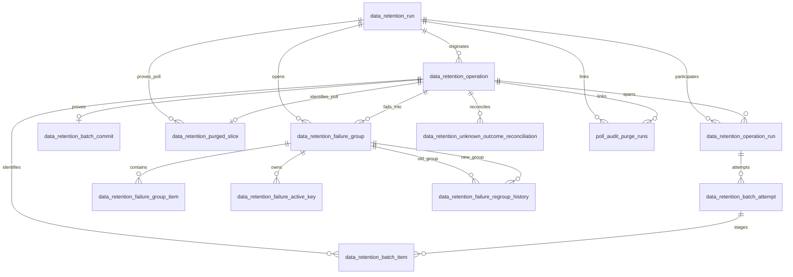

# 数据定期清理 P0 WP2 数据库治理 SPEC（评审通过版）

文档状态：第五次评审通过，允许开展 WP2 DDL 与测试开发；未授权启用任何 execute 开关

实施状态：WP2 本地准入尚未完成。V354 精确结构 guard 与 fingerprint 半空约束按实施评审修订；仓库真实 V1→V354 空库迁移链仍在 V133 阻断。在该历史链单独修复或形成正式书面豁免前，不得把 WP2 表述为“只剩生产克隆验收”。

文档日期：2026-08-11

适用数据库：MySQL 8.0；生产基线版本为 MySQL 8.0.46

实施迁移号：V354；开发开始前已复核全部本地/远端 refs、可访问 worktree 和未跟踪迁移，最高既有版本为 V353

关联范围：WP2 Flyway DDL、迁移契约测试、MySQL 8 集成测试、五年容量估算

---

## 0. 评审修订摘要

### 0.1 第一次评审

| 评审问题 | 修订结论 |
|---|---|
| attempt 永久 FK 与 365 天清理冲突 | 新增永久 operation；永久证据不再引用 attempt；具体 365 天起算规则已在第三次评审统一为 operation anchor |
| child operation/domain 不一致 | operation 建立永久 identity；mutation child 使用包含 operation/run/domain 的复合 FK |
| active key 可指向错误 item | failure item 增加 domain；active key 使用 group/domain/business key/item id 完整复合 FK |
| batch hash 遗漏执行边界 | 恢复 cutoff、upperBound、policyVersion、configFingerprint，并在 operation/marker 显式保存边界 |
| 200 行容量样本不足 | 改为全表同比例、多规模、空表增量、典型/近上限双数据集 |
| 二次 migrate 不能证明恢复 | 改为真实迁移链、指定步骤故障、failed/repair/re-migrate 测试 |
| 复合 FK 子索引不完整 | 所有复合 FK 显式列出确定名称和完整列顺序，并纳入 information_schema/容量断言 |

本文仍处于待复审状态；以上修订不构成进入 DDL 开发的授权。

### 0.2 第二次评审

| 评审问题 | 修订结论 |
|---|---|
| operation 永久绑定单一 run | operation 仅保存 `origin_run_group_id`；新增永久 `data_retention_operation_run`，origin/retry/reconcile 每次顶层请求创建自己的 run 并关联同一 operation |
| poll operation 无可恢复 canonical scope | 冻结 poll hash v1；operation 规范化保存 project/date/tier/cutoff；purged slice 新增 nullable `operation_id` 及精确 scope 复合 FK |
| application version 被创建版本冻结 | operation 保存 `created_application_version`，commit 保存 `committed_application_version`；application version 不进入 operation→commit 一致性 FK |
| 5 GB 验收与 5.21 GB fail-closed 包络冲突 | 5 GB 仅约束正常清理稳态加 30% 预留；无清理包络改为积压、告警和停机阈值依据 |
| fingerprint schema version 未持久化 | run、operation、commit 新增 `config_fingerprint_schema_version`，并纳入 hash 和 commit contract |
| 次要 CHECK 与字段语义缺口 | 补充 sequence/attempt 下界、run scope 8 KB CHECK，并明确 `attempt_detail_purged_at` 仅表示 eligible detail 已清理 |

本文仍处于第二次评审后的待复审状态；未授权创建迁移文件、修改 Java writer 或执行 DDL。

### 0.3 第三次评审

| 评审问题 | 修订结论 |
|---|---|
| 跨 run 明细缺少统一保留锚点 | operation 新增 `outcome_finalized_at` 与单调递增的 `detail_retention_anchor_at`；mutation attempt/item 统一按 operation 锚点满 365 天清理，终态 attempt 保持不可变 |
| fingerprint v1 无法独立重现 | 冻结 website/poll 精确 key、顺序、有效值归一化规则，并增加两组固定 UTF-8/LF SHA-256 测试向量 |
| origin relation 语义未闭合 | `operation.origin_run_group_id` 是唯一权威来源；operation-run 的 origin 行是其物化投影，增加 generated-column 唯一约束、同事务强校验和异常数据检测测试 |

本文仍处于第三次评审后的待复审状态；未授权创建迁移文件、修改 Java writer 或执行 DDL。

### 0.4 第四次评审

| 评审问题 | 修订结论 |
|---|---|
| detail 删除后锚点仍可能推进 | operation 新增永久 `detail_purged_at`；WP8 必须锁 operation、重新验证并在同一事务删除完整 detail tree 和设置 marker；marker 后审计可补写但禁止推进锚点或创建 detail |
| scope hash 缺少固定输出 | website/poll canonical 示例代入已冻结的默认 fingerprint，并增加经 .NET 与 Node 双实现复核的最终 SHA-256 向量 |

本文仍处于第四次评审后的待复审状态；未授权创建迁移文件、修改 Java writer 或执行 DDL。

### 0.5 第五次评审（最终批准）

| 评审问题 | 修订结论 |
|---|---|
| 全局锁顺序与 batch item FK 写入顺序相反 | 统一为 operation → reconciliation/failure gate → attempt → batch item；首次 writer 先创建/锁定父 attempt 再写 item，WP8 获取全部锁后仍按 item → attempt 删除 |

第五次评审未发现新的 P0/P1。上述修订完成后，WP2 SPEC 评审通过，允许开展 WP2 Flyway DDL 与测试开发；本批准不授权打开任何 retention execute 开关，也不授权执行业务或生产清理。

### 0.6 WP2 实施评审

| 实施问题 | 处理结论 |
|---|---|
| `CREATE TABLE IF NOT EXISTS` 恢复 guard 只验证数量/名称 | 对 V354 新表及既有表新增对象，从 `information_schema.tables/columns/statistics/key_column_usage/referential_constraints/check_constraints` 生成规范化 SHA-256；精确覆盖列类型/默认值/generated expression、索引列序、FK 两端与规则、CHECK 表达式，并增加同字段数错误类型、同名错误索引顺序、同名错误 CHECK 的 repair/re-migrate 测试 |
| run fingerprint pair CHECK 存在 MySQL `UNKNOWN` 漏洞 | 非空分支显式要求 fingerprint 与 schema version 都非空；真实 MySQL 覆盖双空、两个半空、合法非空和 version 0 |
| 集成测试使用抽取的 retention 基线，不是真实 V1→V354 | 测试和文档统一改称“抽取的 retention 基线”；另以真实空库链诊断并固定 V133 阻断。不得修改已发布 V133；必须选择单独历史链修复，或由批准人签署“可信 V353 实库导出基线 + V354”豁免并记录导出物哈希、来源、日期和剩余风险 |
| CHECK 签名对整个表达式 `LOWER`，忽略大小写敏感常量 | 直接签名 MySQL `information_schema.check_constraints.check_clause` 的原始规范化输出，不再对 CHECK 做 `LOWER`、空白/反引号移除或 introducer 替换，完整保留字符串字面量字节，并增加 `ascii_bin relation_type` 合法值全改大写的 repair/re-migrate 回归 |

前两项属于已批准 WP2 DDL/测试范围。第三项仍是 WP2 准入阻断项，不因抽取基线的 V354 测试通过而关闭。

2026-08-11 修订后复跑结果：SQL 契约测试 6/6 通过；MySQL 8.0.45 required profile 8/8 通过，其中包含同字段数错误类型、同名错误索引顺序、数值 CHECK 变异、`ascii_bin` 字符串常量大小写变异四个失败→清理残留→Flyway repair→重迁场景，fingerprint 五种边界组合、容量全规模测试，以及一个“真实空库链必须停在 V133”的预期失败诊断。最后一项是对阻断状态的证据，不是 V1→V354 验收通过。

---

## 1. 评审目标

WP2 只建立数据定期清理 P0 所需的持久化治理基础，不实现协调器、动态 Redis 开关、批量清理算法或自动调度执行。

本 SPEC 已审核通过，WP2 应交付：

1. 一组幂等、可从部分完成状态恢复的 Flyway DDL；
2. `data_retention_run` 的 run group 扩展，不新增语义重复的 run group 表；
3. 永久 operation、operation-run 关联、可清理 batch attempt、官网 commit marker、failure group、动态开关审计和 unknown outcome reconciliation 表；
4. 官网 batch business key 的规范化明细，确保进程重启后仍可执行 unknown outcome reconciliation；
5. `data_retention_purged_slice` 的直接 operation identity，以及 `poll_audit_purge_runs` 的可索引 run/operation/domain 关联列；
6. mutation attempt/item 按 operation 最终结果锚点保留 365 天并清理的数据契约；
7. SQL 形状契约测试和 MySQL 8 真实 DDL 集成测试；
8. 包含数据与索引的五年容量测算、监控口径和告警阈值。

审核通过不代表允许打开任何 execute 开关。WP2 上线后仍必须保持所有 retention scheduler/execute 开关为 `false`。

---

## 2. 当前基线

### 2.1 已有永久表

当前已有：

- `data_retention_run`：一次当前服务调用创建一条，尚不具备顶层触发上下文；
- `data_retention_purged_slice`：轮询切片不可逆清理 marker，保留 `retention_run_id` 外键；
- `data_retention_recompute_slice_lock`：轮询切片事务锁；
- `poll_audit_purge_runs`：轮询物理清理预提交审计，目前 retention 关联只在 `scope_json` 中。

冻结保留策略：execute run group、operation、commit marker、purged slice marker 永久保留；mutation attempt/item 在 operation 最终结果锚点满 365 天且无未解决状态后可清理。WP2 不得用永久 RESTRICT FK 反向阻止该清理策略。

### 2.2 已确认迁移状态

- V335、V336、V348 已提交，不得删除、覆盖或改号；
- 当前仓库和可见并行 worktree 未发现 V354 以上迁移；
- 开发开始时必须重新运行迁移号占用检查；
- 本 SPEC 使用 `<NEXT_VERSION>` 表示最终迁移号，不把 V354 写成永久约束。

### 2.3 当前测试能力

- 项目使用 Java 17、JUnit 5、Spring JDBC 和 Flyway；
- 已包含 Testcontainers 1.19.7 与 MySQL 容器依赖；
- 现有官网清理 JDBC 测试使用 H2 MySQL 模式，只能验证 SQL 形状，不能证明 MySQL 锁、约束和 DDL 行为；
- WP2 必须增加 MySQL 8 集成测试，不能只增加读取 SQL 文本的测试。

---

## 3. 范围与非范围

### 3.1 WP2 范围

- 新表、列、索引、唯一约束、检查约束和外键；
- 历史数据兼容与可空策略；
- Flyway 部分执行恢复策略；
- canonical hash 的数据库存储契约；
- 审计字段大小限制；
- 迁移契约测试；
- MySQL 8 DDL、唯一性、外键和容量测试；
- 最终 DDL 容量估算。

### 3.2 WP2 非范围

- `DataRetentionExecuteCoordinator`；
- Redis lease 泛化；
- Redis/MySQL 动态开关读写、CAS 和对账代码；
- 20→10→5 拆分算法；
- failure group 服务和人工 regroup API；
- commit marker 写入服务和 unknown outcome 判定服务；
- 人工、scheduler、canary、retry、reconcile 入口接线；
- 轮询业务谓词、切片粒度或删除顺序调整；
- 监控采集器、告警通知和生产开关启用；
- 本地 MinIO、COS 或对象存储改造；
- 凭据治理。

---

## 4. 冻结不变量

1. `data_retention_run` 就是 run group，不新增 `data_retention_run_group`。
2. 一次人工请求或一次领域定时触发只创建一条 run；分页、拆分和重试进入 batch attempt。
3. 同一调度周期的多领域 run 共享 `trigger_id`，每个领域各有一条 run。
4. 官网不可逆清理必须在业务事务内写入 `data_retention_batch_commit`。
5. 轮询继续使用 `data_retention_purged_slice` 作为不可逆 marker，不复制一份语义相同的 poll commit 表。
6. `data_retention_purged_slice.retention_run_id` 外键必须保留。
7. failure group 最小自动失败组不拆为单篇；DDL 必须支持 active business key 全局唯一。
8. 关闭 failure group 与删除 active key 必须能在同一事务完成。
9. regroup 不删除旧 group、旧 item 或历史映射。
10. Redis 是动态开关运行时真实状态；MySQL 表只保存 requested/applied/failed 审计和最终一致性依据。
11. unknown outcome 记录不得保存正文、payload、raw response 或文章 ID 数组。
12. 所有永久审计表禁止 `ON DELETE CASCADE`；永久父记录使用 RESTRICT。可清理 attempt 及其 detail 按明确清理顺序删除，不允许永久证据依赖 attempt FK。
13. 新 DDL 不设置或修改任何 execute 开关。
14. unknown outcome 必须能够从 MySQL 恢复本批 business key；不能依赖不可逆 hash、进程内存或日志反推。
15. mutation attempt/item 从 operation `detail_retention_anchor_at` 起至少保留 365 天；operation 未最终化、聚合未完成、unknown/manual review 未关闭或 failure group 仍 active 时不得清理。
16. `batch_key_hash` 必须覆盖完整 operation scope，不得退化为纯成员集合 hash。
17. 一次顶层 retry/reconcile 请求创建自己的 run；它复用原 operation，但不得重新打开或重算原 run 的 rollup。
18. mutation detail 只能在 operation 行锁内整棵原子删除并永久设置 `detail_purged_at`；marker 后锚点冻结，禁止创建新 detail。

---

## 5. 标识、时间和哈希契约

### 5.1 标识

- `trigger_id`、`operation_id`、`change_id`、`reconciliation_id`、`regroup_operation_id` 使用规范化小写 UUID 字符串；
- 数据库存储类型统一为 `CHAR(36) CHARACTER SET ascii COLLATE ascii_bin`；
- 本期不使用 MySQL `UUID_TO_BIN`，避免 Java、SQL、排障工具之间出现字节序歧义；
- `operation_id` 表示一个逻辑不可逆 mutation 单元；已知回滚后的重试和 unknown outcome reconcile 必须沿用原 `operation_id`；
- batch attempt 通过 `(operation_id, attempt_no)` 区分同一逻辑 mutation 的多次尝试。

### 5.2 时间

- 所有新时间列使用 `DATETIME(3)`；
- 应用写入时统一使用 UTC；
- canonical hash 中的时间使用 UTC ISO-8601，固定毫秒精度和 `Z` 后缀，例如 `2026-08-11T03:30:00.000Z`；
- 数据库默认时间只用于 `created_at`、`updated_at` 等审计兜底，不能参与业务 hash。

### 5.3 batch key hash（完整 operation scope hash）

- 存储类型：`BINARY(32)`；
- 算法：完整 SHA-256，不截断；
- 输入编码：UTF-8；
- 换行：LF；
- 官网 business key 是十进制 article ID，不允许前导零；
- business key 按数值升序；
- hash 必须包含 `cutoff`、`upperBound`、`policyVersion`、`configFingerprintSchemaVersion` 和 `configFingerprint`；
- `configFingerprint` 在 canonical 文本中使用 64 位小写十六进制；
- 空值固定写作 `<null>`；
- `hash_schema_version` 初始值为 `1`。

版本 1 字段顺序及固定测试向量（使用第 5.4.1 节默认 fingerprint）：

```text
hashSchemaVersion=1
domain=website_published_content
businessKeyType=article_id
itemCount=5
businessKey[0]=101
businessKey[1]=205
businessKey[2]=309
businessKey[3]=410
businessKey[4]=512
cutoff=2026-08-10T03:30:00.000Z
upperBound=512
policyVersion=website-published-v1
configFingerprintSchemaVersion=1
configFingerprint=5f19f515ba805e342bcc076c5ce56cc4cc4ac20b08dc27a70c2dba5f1fbc2cbd
```

字段顺序固定为上述顺序，最后一行也必须以 LF 结束，不得对整段文本做 trim。官网 P0 的 `cutoff` 和 `upperBound` 必须显式存在，不能写 `<null>`；`upperBound` 是本次选择快照允许纳入的最大 article ID。

上述 UTF-8/LF 字节串的 `batch_key_hash` SHA-256 小写 hex 必须为：

```text
14a67e69ebea79dea3c01abef4cd982c8fcb22303ec519941e7f319c633abbe7
```

`batch_key_hash` 的语义是完整 operation scope，而不是纯成员集合。相同 domain、成员、cutoff、upperBound、policy 和 config 必须得到相同 hash；任一边界不同都必须得到不同 hash。

### 5.4 config fingerprint

- 存储类型：`BINARY(32)`；
- 独立版本列：`config_fingerprint_schema_version SMALLINT UNSIGNED`，初始值为 `1`；
- 算法：完整 SHA-256；
- v1 只包含下文逐 domain 冻结的、影响清理资格、事务粒度和后置校验的有效配置；实施方不得自行增删字段；
- 字段名区分大小写并按 ASCII 升序，每行 `key=value`，UTF-8 无 BOM、只使用 LF，最后一行也保留 LF；不得 trim 整段文本；
- 不包含密钥、令牌、审批备注或正文数据；
- 字段集合变化时提升 `config_fingerprint_schema_version`，不能静默改变原版本含义；
- run、operation 和 commit 都必须持久化该版本；operation scope hash 和 operation→commit contract 都必须包含该版本；
- `hash_schema_version` 只版本化 operation scope 的序列化格式，不能代替 fingerprint schema version。

v1 公共值规范：

- 布尔值只能是小写 `true`/`false`；
- 有符号或无符号整数均使用十进制，不带 `+`、前导零、分组符或小数点；零只能写 `0`；
- 枚举值使用下文给出的 ASCII 小写 snake_case token，不做本地化；
- 日期若未来某个 schema 明确列入，使用 `YYYY-MM-DD`；instant 使用 UTC、固定毫秒和 `Z` 的 ISO-8601；v1 当前字段集合不含日期或 instant；
- 时区使用大小写固定的 IANA zone ID；v1 只能写 `Asia/Shanghai`，不能写 `UTC+8`、`CST` 或系统默认时区别名；
- 请求未配置时先应用下文默认值和最小值归一化，再 hash 有效值；不能把“未配置”写成 `<null>`。v1 两个 domain 均没有 nullable key；
- 动态 execute 开关、scheduler cron、分页 limit/cursor、max-batches-per-run、lease key/TTL、operator、reason、approval 和 application version 不影响单个 mutation 的资格/原子粒度/后置条件，不进入 v1 fingerprint；
- 官网 target/status SQL 集合、轮询删除顺序和安全谓词等不可运行时配置的代码规则由 `policy_version` 版本化；任一规则变化必须提升 policy version。它们不得在不提升 policy version 的情况下以“不是 fingerprint 字段”为由静默变化。

#### 5.4.1 `website_published_content` fingerprint schema v1

精确 key 集合和值来源如下，表中顺序就是 canonical 顺序：

| key | v1 值与归一化 |
|---|---|
| `batchMaxItems` | 固定 `20` |
| `batchMinItems` | 固定 `5`；禁止自动拆成单篇 |
| `businessTimezone` | 固定 `Asia/Shanghai`；cutoff 随后转换为第 5.2 节 UTC instant；当前 website service 的隐式系统时区必须在 WP6 显式化后才能 execute |
| `postCheckMode` | 固定 `locked_rows_only` |
| `requireBodyPurged` | 固定 `true` |
| `requireLightweightEvidencePreserved` | 固定 `true` |
| `requireMarkerPresent` | 固定 `true` |
| `requirePayloadPurged` | 固定 `true` |
| `requireRawResponsePurged` | 固定 `true` |
| `retentionHours` | execute 请求的有效保护小时；NULL 使用 `24`，小于 `24` 提升为 `24`，其他正整数原值保留 |
| `splitStrategy` | 固定 `halve_to_min_5`，对应 20→10→5 |

固定测试向量：

```text
batchMaxItems=20
batchMinItems=5
businessTimezone=Asia/Shanghai
postCheckMode=locked_rows_only
requireBodyPurged=true
requireLightweightEvidencePreserved=true
requireMarkerPresent=true
requirePayloadPurged=true
requireRawResponsePurged=true
retentionHours=24
splitStrategy=halve_to_min_5
```

上述文本最后含一个 LF，SHA-256 小写 hex 必须为：

```text
5f19f515ba805e342bcc076c5ce56cc4cc4ac20b08dc27a70c2dba5f1fbc2cbd
```

#### 5.4.2 `poll_results` fingerprint schema v1

精确 key 集合和值来源如下，表中顺序就是 canonical 顺序：

| key | v1 值与归一化 |
|---|---|
| `businessTimezone` | 固定 `Asia/Shanghai`，与当前 `PollRetentionDryRunService.BUSINESS_ZONE` 一致 |
| `hotRetentionDays` | execute 请求的有效 hot window；NULL 使用 `14`，小于 `14` 提升为 `14`，其他正整数原值保留 |
| `lateWritePolicy` | 固定 `http_409` |
| `preserveLatest` | 固定 `true` |
| `requireAllChildrenPurged` | 固定 `true` |
| `requireMarkerPresent` | 固定 `true` |
| `requireSummaryConsistent` | 固定 `true` |
| `sliceTransactionMode` | 固定 `single_slice`；一个 `(project_id,batch_date,question_tier)` 为一个原子 transaction |
| `stuckBatchSealDays` | 请求为 NULL 或 ≤0 时使用 `7`，正整数原值保留 |

固定测试向量：

```text
businessTimezone=Asia/Shanghai
hotRetentionDays=14
lateWritePolicy=http_409
preserveLatest=true
requireAllChildrenPurged=true
requireMarkerPresent=true
requireSummaryConsistent=true
sliceTransactionMode=single_slice
stuckBatchSealDays=7
```

上述文本最后含一个 LF，SHA-256 小写 hex 必须为：

```text
a3d60a41c13633f7f40c1fbaf90e8086e19401b05efc4d658cc52b25b23d1b7c
```

WP3/WP6/WP7 必须共享同一个 canonical encoder。契约测试必须直接以以上字节串验证 hex 和写入数据库后的 `BINARY(32)`；不能仅比较同一实现计算出的两个结果。

### 5.5 poll slice canonical scope

轮询 operation 定位一个精确切片，不复用官网 article ID 格式。永久业务身份是：

```text
(project_id, batch_date, question_tier)
```

版本 1 字段顺序及固定测试向量（使用第 5.4.2 节默认 fingerprint）：

```text
hashSchemaVersion=1
domain=poll_results
projectId=1
batchDate=2026-05-26
questionTier=A
cutoff=2026-07-28
upperBound=<null>
policyVersion=poll-results-v1
configFingerprintSchemaVersion=1
configFingerprint=a3d60a41c13633f7f40c1fbaf90e8086e19401b05efc4d658cc52b25b23d1b7c
```

上述 UTF-8/LF 字节串的 `batch_key_hash` SHA-256 小写 hex 必须为：

```text
2d6d6c4ccf5609e29a14773efc97125dcd7746e192be7bc1f163b274c06eedad
```

语义：

- `projectId` 使用无前导零十进制；
- `batchDate` 使用 ISO `YYYY-MM-DD`；
- `questionTier` trim 后转大写，必须与 `data_retention_purged_slice.question_tier` 使用相同长度、字符集和 collation；
- `cutoff` 是运行时 hot-retention 规则计算出的最晚可清理日期，即当前实现中的 `cutoffDate`；
- exact slice 没有扫描 upper bound，必须显式序列化为 `<null>`，不能省略该行；
- 字段顺序、UTF-8、LF、末尾 LF 和空值规则与官网 hash 相同；
- operation 必须规范化保存 `poll_project_id`、`poll_batch_date`、`poll_question_tier` 和 `poll_retention_cutoff_date`，不能依赖 hash 反推；
- `data_retention_purged_slice` 必须增加 nullable `operation_id`，新写入直接关联 operation，历史 marker 保持 NULL。

第 5.3 与 5.5 节两个 scope 向量已分别使用 .NET SHA-256 和 Node `crypto` 对相同 UTF-8/LF 字节串交叉复核且结果一致。正式契约测试仍必须从固定字节串独立计算，不能调用生产 canonical encoder 后只做自我比较。

---

## 6. 数据模型总览



动态开关审计独立于某次 run；开关变更可能发生在没有运行任务时，因此不强制关联 `data_retention_run`。

### 6.1 公共物理约定

- 所有新表使用 `ENGINE=InnoDB DEFAULT CHARSET=utf8mb4 COLLATE=utf8mb4_unicode_ci`，与现有 retention 审计表保持一致；
- UUID、operation、switch key、business key、状态、类型、policy/application version 等机器字段显式使用 ASCII 字符集；需要区分大小写的标识使用 `ascii_bin`；
- `domain` 保持 `VARCHAR(64)` 和现有 `data_retention_run.domain` 相同的 utf8mb4 collation，以支持 run/operation 复合 FK；
- 展示或人工输入的 reason/error 字段使用表默认 utf8mb4；
- PK/FK 两侧的 signed/unsigned、长度和类型必须完全一致；
- 所有 FK 显式命名，delete rule 使用 `RESTRICT`；
- 所有索引名在 schema 内遵循现有 `uk_`/`idx_`/`fk_` 前缀且不超过 MySQL 64 字符限制；
- 新表都包含 `created_at`；有可变状态的表同时包含 `updated_at`。

### 6.2 复合 FK 与显式子索引矩阵

不得依赖 InnoDB 自动创建未命名或实现相关的子索引。DDL、契约测试和容量测试以此矩阵为准：

| 子表 FK 列 | 显式子索引 | 父表被引用键 |
|---|---|---|
| operation `(origin_run_group_id,domain)` | `idx_retention_operation_origin_domain` | run `uk_retention_run_id_domain` |
| operation-run operation contract `(operation_id,domain,config_fingerprint_schema_version,config_fingerprint,policy_version)` | `idx_retention_operation_run_operation_domain` | operation `uk_retention_operation_execution_contract` |
| operation-run run contract `(run_group_id,domain,config_fingerprint_schema_version,config_fingerprint,policy_version)` | `idx_retention_operation_run_run_domain` | run `uk_retention_run_execution_contract` |
| attempt `(run_group_id,domain)` | `idx_retention_attempt_run_domain` | run `uk_retention_run_id_domain` |
| attempt `(operation_id,run_group_id,domain)` | `idx_retention_attempt_operation_identity` | operation-run `uk_retention_operation_run_identity` |
| commit `(operation_id,run_group_id,domain)` | `idx_retention_batch_commit_operation_run` | operation-run `uk_retention_operation_run_identity` |
| commit 官网 operation contract | `idx_retention_batch_commit_contract` | operation `uk_retention_operation_website_contract` |
| batch item `(operation_id,run_group_id,domain,first_attempt_id)` | `idx_retention_batch_item_attempt` | attempt `uk_retention_attempt_operation_id` |
| failure group `(operation_id,source_run_group_id,domain)` | `idx_retention_failure_group_operation` | operation-run `uk_retention_operation_run_identity` |
| failure item `(group_id,domain)` | `idx_retention_failure_item_group_domain` | group `uk_retention_failure_group_id_domain` |
| active key `(group_id,domain,business_key,group_item_id)` | `idx_retention_failure_active_ref` | item `uk_retention_failure_item_active_ref` |
| regroup old `(old_group_id,domain)` | `idx_retention_regroup_old_group` | group `uk_retention_failure_group_id_domain` |
| regroup new `(new_group_id,domain)` | `idx_retention_regroup_new_group` | group `uk_retention_failure_group_id_domain` |
| reconciliation `(operation_id,run_group_id,domain)` | `idx_retention_reconciliation_identity` | operation-run `uk_retention_operation_run_identity` |
| purged slice `(operation_id,retention_run_id,domain)` | `idx_retention_purged_slice_operation_run` | operation-run `uk_retention_operation_run_identity` |
| purged slice `(operation_id,domain,project_id,batch_date,question_tier)` | `idx_retention_purged_slice_operation_scope` | operation `uk_retention_operation_poll_scope` |
| poll audit `(operation_id,retention_run_id,retention_domain)` | `idx_poll_audit_purge_operation` | operation-run `uk_retention_operation_run_identity` |

batch item 的完整 attempt 索引同时覆盖其 operation FK 前缀，不再额外创建冗余 operation 子索引。

---

## 7. `data_retention_run` 扩展

不重建现有表，只增加以下列：

| 列 | 类型 | 可空 | 说明 |
|---|---|---:|---|
| `trigger_id` | `CHAR(36)` ASCII/BIN | 是 | 同一顶层调度周期或人工触发标识；历史行保持 NULL |
| `trigger_source` | `VARCHAR(24)` | 是 | `manual/scheduler/canary/retry/reconcile` |
| `requested_by` | `BIGINT` | 是 | 人工操作者；系统触发可为调度账号 |
| `request_reason` | `VARCHAR(500)` | 是 | 顶层执行原因，不保存业务数据 |
| `approval_ref` | `VARCHAR(128)` | 是 | 审批编号或外部引用 |
| `ticket_ref` | `VARCHAR(128)` | 是 | 工单编号或外部引用 |
| `scope_json` | `JSON` | 是 | 顶层轻量范围，最大 8 KB |
| `config_fingerprint` | `BINARY(32)` | 是 | 顶层配置指纹 |
| `config_fingerprint_schema_version` | `SMALLINT UNSIGNED` | 是 | fingerprint 字段集合版本；历史行保持 NULL |
| `policy_version` | `VARCHAR(64)` ASCII/BIN | 是 | 清理策略版本；与 operation-run FK 列型完全一致 |
| `application_version` | `VARCHAR(64)` ASCII/BIN | 是 | 创建该 run 的部署版本或 Git SHA；retry/reconcile 新 run 可使用新版本 |
| `attempt_count` | `BIGINT UNSIGNED` | 否 | run 完成时聚合的 attempt 总数，历史默认 0 |
| `succeeded_attempt_count` | `BIGINT UNSIGNED` | 否 | run 聚合成功数，历史默认 0 |
| `failed_attempt_count` | `BIGINT UNSIGNED` | 否 | run 聚合失败数，历史默认 0 |
| `skipped_attempt_count` | `BIGINT UNSIGNED` | 否 | run 聚合跳过数，历史默认 0 |
| `unknown_attempt_count` | `BIGINT UNSIGNED` | 否 | run 聚合 unknown/manual review 数，历史默认 0 |
| `attempt_rollup_completed_at` | `DATETIME(3)` | 是 | attempt 汇总完成时间 |
| `attempt_detail_purged_at` | `DATETIME(3)` | 是 | 本 run 当前所有到期 eligible 明细清理完成时间 |

新增索引：

- `UNIQUE KEY uk_retention_run_trigger_domain (trigger_id, domain)`；
- `UNIQUE KEY uk_retention_run_id_domain (id, domain)`，供 operation 复合 FK 使用；
- `UNIQUE KEY uk_retention_run_execution_contract (id, domain, config_fingerprint_schema_version, config_fingerprint, policy_version)`，供 operation-run 校验当前 run 的有效策略/config；历史 NULL 行不影响新关联；
- `KEY idx_retention_run_source_started (trigger_source, started_at)`；
- 保留现有 domain/status/approval 索引。

兼容策略：

- 所有新增列先允许 NULL，不能为历史 run 伪造 trigger、操作者或版本；
- WP3 新 writer 必须对 execute run 填写 `trigger_id`、`trigger_source`、`requested_by`、`config_fingerprint_schema_version`、`config_fingerprint`、`policy_version` 和 `application_version`；
- dry-run 是否强制填写同样上下文由 WP3 决定，但推荐统一填写；
- 现有 `metrics_json` 和 `error_message` 不改列型，避免破坏历史数据；WP3 对新写入执行 8 KB/2 KB UTF-8 字节限制。
- 新增 `CHECK (scope_json IS NULL OR OCTET_LENGTH(CAST(scope_json AS CHAR)) <= 8192)`；历史行该列不存在，迁移后默认 NULL，不存在旧值兼容障碍；
- 新增 `CHECK ((config_fingerprint IS NULL AND config_fingerprint_schema_version IS NULL) OR (config_fingerprint IS NOT NULL AND config_fingerprint_schema_version IS NOT NULL AND config_fingerprint_schema_version >= 1))`；显式的第二个 `IS NOT NULL` 用于阻断 MySQL CHECK `UNKNOWN` 接受 fingerprint 半空状态；
- attempt 汇总计数在 run 结束事务中固化；只有 `attempt_rollup_completed_at` 已设置且计数与明细一致，才允许进入 365 天清理候选。
- `attempt_detail_purged_at` 表示“截至该次成功清理 sweep，该 run 所有当时已到期 eligible attempt/item detail 已清理”；尚未达到 operation retention anchor +365 天、仍有未解决状态或 operationless detail 尚未到期的记录可以继续存在，因此它不表示 attempt 表中已无该 run 的记录。
- 该列是可向后更新的观测水位，不是永久 complete flag。旧 unknown 在后来 reconcile 后会产生新的未来到期 detail；WP8 必须始终从 operation anchor 索引重新扫描，禁止仅凭既有 `attempt_detail_purged_at` 跳过 run。
- mutation detail 是否已永久清理只以 operation `detail_purged_at` 为准；run 水位不得替代、清空或反推该 marker。

---

## 8. operation 与多 run 关联

### 8.1 `data_retention_operation`

用途：永久保存逻辑 mutation 身份、完整 scope、最终结果时间和 detail purge 生命周期 marker。operation 是可清理 attempt 与永久 marker/reconciliation/poll audit 之间的稳定父记录，不是第二张 run group 表。

| 列 | 类型 | 约束/说明 |
|---|---|---|
| `operation_id` | `CHAR(36)` ASCII/BIN | 主键，逻辑 mutation 标识 |
| `origin_run_group_id` | `BIGINT UNSIGNED` | 非空，首次创建 operation 的 run；后续不改变 |
| `domain` | `VARCHAR(64)` | 非空，与 run domain 相同 collation |
| `operation_type` | `VARCHAR(32)` ASCII/BIN | `website_batch/poll_slice` |
| `batch_key_hash` | `BINARY(32)` | 非空，完整 operation scope SHA-256 |
| `hash_schema_version` | `SMALLINT UNSIGNED` | 非空 |
| `item_count` | `INT UNSIGNED` | 非空，官网 1～20；轮询为 1 |
| `cutoff_at` | `DATETIME(3)` | 官网非空；轮询为空，轮询日期边界使用 `poll_retention_cutoff_date` |
| `upper_bound_business_key` | `BIGINT UNSIGNED` | 官网非空，为选择快照最大 article ID |
| `poll_project_id` | `BIGINT` | poll 非空，与 purged slice project_id 同类型 |
| `poll_batch_date` | `DATE` | poll 非空 |
| `poll_question_tier` | `VARCHAR(16)` | poll 非空，与 purged slice 相同字符集/collation |
| `poll_retention_cutoff_date` | `DATE` | poll 非空，为 canonical `cutoff` |
| `config_fingerprint_schema_version` | `SMALLINT UNSIGNED` | 非空 |
| `config_fingerprint` | `BINARY(32)` | 非空 |
| `policy_version` | `VARCHAR(64)` ASCII/BIN | 非空 |
| `created_application_version` | `VARCHAR(64)` ASCII/BIN | 非空，仅记录创建 operation 的代码版本 |
| `outcome_status` | `VARCHAR(24)` ASCII/BIN | 非空；`pending/committed/rolled_back/unknown/manual_review/closed_no_mutation` |
| `outcome_finalized_at` | `DATETIME(3)` | 可空；治理层首次确认最终结果的 UTC 时间 |
| `outcome_finalization_source` | `VARCHAR(24)` ASCII/BIN | 可空；最终状态时为 `website_commit/poll_marker/reconciliation/terminal_attempt` |
| `outcome_finalization_reason` | `VARCHAR(64)` ASCII/BIN | 可空；稳定 token，如 `committed/verified_no_mutation`，不保存自由文本 |
| `detail_retention_anchor_at` | `DATETIME(3)` | 可空；所有 mutation attempt/item 的统一 365 天保留锚点，只能向后推进 |
| `detail_purged_at` | `DATETIME(3)` | 可空；完整 operation detail tree 已原子删除的永久 UTC marker，只能从 NULL 设置一次 |
| `created_at` / `updated_at` | `DATETIME(3)` | 审计时间 |

约束和索引：

- `PRIMARY KEY (operation_id)`；
- `UNIQUE KEY uk_retention_operation_scope (domain, batch_key_hash)`；
- `UNIQUE KEY uk_retention_operation_identity (operation_id, domain)`；
- `UNIQUE KEY uk_retention_operation_execution_contract (operation_id, domain, config_fingerprint_schema_version, config_fingerprint, policy_version)`，供 operation-run 锁定策略/config；
- `UNIQUE KEY uk_retention_operation_website_contract (operation_id, domain, batch_key_hash, hash_schema_version, item_count, cutoff_at, upper_bound_business_key, config_fingerprint_schema_version, config_fingerprint, policy_version)`，供官网 commit marker 复合 FK 使用；
- `UNIQUE KEY uk_retention_operation_poll_scope (operation_id, domain, poll_project_id, poll_batch_date, poll_question_tier)`，供 purged slice marker 复合 FK 使用；
- `KEY idx_retention_operation_origin_run (origin_run_group_id, created_at)`；
- `KEY idx_retention_operation_status (domain, outcome_status, created_at)`；
- `KEY idx_retention_operation_detail_retention (detail_purged_at, detail_retention_anchor_at, outcome_status, operation_id)`，供 WP8 先筛选未清理且已到期 operation；
- `KEY idx_retention_operation_origin_domain (origin_run_group_id, domain)`；
- `(origin_run_group_id, domain)` 复合 FK → run `(id, domain)`，使用 `ON DELETE RESTRICT`；
- `CHECK ((operation_type = 'website_batch' AND item_count BETWEEN 1 AND 20) OR (operation_type = 'poll_slice' AND item_count = 1))`；
- `CHECK (hash_schema_version >= 1)`；
- `CHECK (config_fingerprint_schema_version >= 1)`；
- `CHECK (outcome_status IN ('pending','committed','rolled_back','unknown','manual_review','closed_no_mutation'))`；
- `CHECK ((outcome_status IN ('committed','closed_no_mutation') AND outcome_finalized_at IS NOT NULL AND outcome_finalization_source IS NOT NULL AND outcome_finalization_reason IS NOT NULL AND detail_retention_anchor_at IS NOT NULL AND detail_retention_anchor_at >= outcome_finalized_at) OR (outcome_status NOT IN ('committed','closed_no_mutation') AND outcome_finalized_at IS NULL AND outcome_finalization_source IS NULL AND outcome_finalization_reason IS NULL AND detail_retention_anchor_at IS NULL AND detail_purged_at IS NULL))`；
- `CHECK (outcome_finalization_source IS NULL OR outcome_finalization_source IN ('website_commit','poll_marker','reconciliation','terminal_attempt'))`；
- `CHECK (detail_purged_at IS NULL OR detail_purged_at >= TIMESTAMPADD(DAY, 365, detail_retention_anchor_at))`；
- `CHECK ((operation_type = 'website_batch' AND domain = 'website_published_content') OR (operation_type = 'poll_slice' AND domain = 'poll_results'))`；
- `CHECK ((operation_type = 'website_batch' AND cutoff_at IS NOT NULL AND upper_bound_business_key IS NOT NULL AND poll_project_id IS NULL AND poll_batch_date IS NULL AND poll_question_tier IS NULL AND poll_retention_cutoff_date IS NULL) OR (operation_type = 'poll_slice' AND cutoff_at IS NULL AND upper_bound_business_key IS NULL AND poll_project_id IS NOT NULL AND poll_batch_date IS NOT NULL AND poll_question_tier IS NOT NULL AND poll_retention_cutoff_date IS NOT NULL))`。

operation 永久保留。attempt 清理后，commit/reconciliation/poll audit 继续通过 operation 获得一致的 origin、domain、scope hash 和策略上下文。retry/reconcile 不修改 `origin_run_group_id`，也不修改 `created_application_version`。

### 8.2 `data_retention_operation_run`

用途：一个 operation 可以参与多个顶层 run。origin、retry 和 reconcile 每次顶层请求仍各自创建一条 run，再通过本表关联同一 operation。`operation.origin_run_group_id` 是 origin 的唯一权威来源；本表的 origin 行只是为统一 attempt FK 而保存的物化投影。

| 列 | 类型 | 约束/说明 |
|---|---|---|
| `operation_id` | `CHAR(36)` ASCII/BIN | 非空 |
| `run_group_id` | `BIGINT UNSIGNED` | 非空，当前顶层请求的 run |
| `domain` | `VARCHAR(64)` | 非空 |
| `config_fingerprint_schema_version` | `SMALLINT UNSIGNED` | 非空，必须同时等于 operation 与当前 run |
| `config_fingerprint` | `BINARY(32)` | 非空，必须同时等于 operation 与当前 run |
| `policy_version` | `VARCHAR(64)` ASCII/BIN | 非空，必须同时等于 operation 与当前 run |
| `relation_type` | `VARCHAR(24)` ASCII/BIN | `origin/retry/reconcile` |
| `origin_operation_id` | `CHAR(36)` ASCII/BIN generated stored | `relation_type=origin` 时生成 `operation_id`，其他类型为 NULL |
| `linked_at` | `DATETIME(3)` | 非空，UTC |
| `created_at` | `DATETIME(3)` | 非空 |

generated expression 冻结为：

```sql
origin_operation_id CHAR(36) CHARACTER SET ascii COLLATE ascii_bin
  GENERATED ALWAYS AS (
    CASE WHEN relation_type = 'origin' THEN operation_id ELSE NULL END
  ) STORED
```

约束和索引：

- `PRIMARY KEY (operation_id, run_group_id)`；
- `UNIQUE KEY uk_retention_operation_run_identity (operation_id, run_group_id, domain)`，供 attempt/commit/failure/reconciliation/poll audit 使用；
- `UNIQUE KEY uk_retention_operation_run_origin_once (origin_operation_id)`；MySQL 允许多条 NULL，因此每个 operation 至多一条 origin 行，同时允许多条 retry/reconcile；
- `KEY idx_retention_operation_run_run_domain (run_group_id, domain, config_fingerprint_schema_version, config_fingerprint, policy_version)`；
- `KEY idx_retention_operation_run_operation_domain (operation_id, domain, config_fingerprint_schema_version, config_fingerprint, policy_version)`；
- operation contract 五列复合 FK → operation `uk_retention_operation_execution_contract`；
- run contract 五列复合 FK → run `uk_retention_run_execution_contract`；
- `CHECK (config_fingerprint_schema_version >= 1)`；
- `CHECK (relation_type IN ('origin','retry','reconcile'))`；
- FK 均使用 `ON DELETE RESTRICT`。

origin 写入契约：

1. 仅 WP3 operation repository 可以创建 operation；创建过程必须在同一 MySQL 事务先写 operation，再写 `relation_type=origin` 且 `run_group_id=origin_run_group_id` 的 operation-run 行；
2. 提交前先锁定 operation，再以 `FOR UPDATE` 读取该 operation 的 origin relation，必须得到恰好一行且 run ID 完全相等；缺失、不相等或多行均抛错并回滚整个创建事务；
3. retry/reconcile repository 只能写对应 relation type，禁止接受调用方传入 `origin`；关联旧 operation 前必须锁定并重新验证其 origin 投影恰好一条且匹配，否则 fail closed；架构测试禁止其他 service/mapper 直接 INSERT 这两张表；
4. generated unique key 在数据库层阻止多条 origin；MySQL CHECK/FK 无法保证“至少一条且 run 相等”，因此不得声称 DDL 单独闭合了后两个条件；
5. 生产迁移后、每次发布前和每日治理巡检必须执行以下只读异常检测，结果非空即阻断 execute：

```sql
SELECT o.operation_id,
       o.origin_run_group_id,
       COUNT(r.operation_id) AS origin_relation_count,
       MAX(r.run_group_id) AS materialized_origin_run_id
  FROM data_retention_operation o
  LEFT JOIN data_retention_operation_run r
    ON r.operation_id = o.operation_id
   AND r.relation_type = 'origin'
 GROUP BY o.operation_id, o.origin_run_group_id
HAVING COUNT(r.operation_id) <> 1
    OR MAX(r.run_group_id) <> o.origin_run_group_id;
```

后续 retry/reconcile 新建自己的 run，并写入对应 relation；新 run 的有效 policy/config 必须与 operation 相同，而 `application_version` 可以反映新部署且不进入本表或上述复合 FK。禁止重新打开或改写原 run 的 rollup。

### 8.3 最终结果与明细保留锚点

`outcome_finalized_at` 表示治理层首次得到不可再重试的最终结论；`detail_retention_anchor_at` 表示从何时开始计算 mutation detail 的 365 天保留期。两者不是 attempt 自身的完成时间。

最终状态只有：

- `committed`：官网 commit marker 或 poll purged-slice marker 已确认存在；
- `closed_no_mutation`：已明确确认未提交业务 mutation，且人工或策略决定不再对该 operation 重试。

`rolled_back` 仅表示当前 attempt 已知回滚且仍可 retry，`unknown/manual_review` 仍需 reconciliation；三者都不是 operation 最终状态，两个时间列必须保持 NULL。

时间推进规则：

1. 正常官网 commit 或 poll marker 事务必须在同一事务把 operation 置为 `committed`，source 分别写 `website_commit/poll_marker`、reason 写 `committed`，并把 `outcome_finalized_at` 与 `detail_retention_anchor_at` 设置为该事务的治理确认时间；
2. unknown/manual review reconciliation 判定为 committed 时，source 写 `reconciliation`、reason 写 `committed`，以 `resolved_at` 设置尚为空的 `outcome_finalized_at`，并把 retention anchor 至少推进到 `resolved_at`；不能回填为一年前的原 attempt `finished_at` 或 marker 业务时间；
3. reconciliation 判定 `safe_to_retry` 时 operation 回到 `rolled_back`，两个时间列继续为 NULL；只有显式“不再执行 mutation”的 resolution 才可置为 `closed_no_mutation` 并以 `resolved_at` 初始化两个时间列；
4. 最后一次终态 attempt 只有在同一事务完成稳定的“无 mutation 且不再 retry”判定时，才可用 source=`terminal_attempt`、reason=`verified_no_mutation` 将 operation 置为 `closed_no_mutation`；普通 known rollback 或 retry 次数耗尽不能自动满足该条件，仍须 reconciliation/人工最终化；
5. operation 已最终化且 `detail_purged_at IS NULL` 时，任何稍后落库的终态 attempt `finished_at`、reconciliation `resolved_at` 或关联 failure group `closed_at` 都必须执行 `detail_retention_anchor_at = max(现值, 事件时间)`；该列禁止清空或减小；
6. reconciliation 最终化时不得存在任何 `prepared/running` mutation attempt；正常 marker 事务最终化时只允许当前持锁 attempt 暂时仍为 running，禁止存在其他并发非终态 attempt，且当前 attempt 必须在事务内或紧随事务终态化并推进 anchor。存在 pending reconciliation、active failure group 或未完成 marker 核验时也禁止最终化；进入 `committed/closed_no_mutation` 后禁止再创建 mutation retry attempt。detail purge 前的补充 reconciliation 按上一条推进锚点；detail purge 后只允许第 8.4 节定义的永久审计补写。

attempt 状态规则：

- attempt 从非终态进入 `succeeded/failed/skipped/unknown/manual_review` 后，`status`、`finished_at`、operation/run identity 和 scope 均不可修改；
- reconciliation 永远新增 reconciliation 行，不把原 `unknown/manual_review` attempt 改写为 succeeded 或 skipped；
- 原 unknown attempt 可以在 operation 最终化、所有未解决状态关闭且 retention anchor 满 365 天后清理；其终态名称本身不再造成永久保留；
- `prepared/running` attempt 永远不是自动清理候选。

应用更新 operation 前必须 `SELECT ... FOR UPDATE`，并使用数据库当前 UTC 时间或已验证不早于现值的事件时间。WP3/WP6/WP7/WP8 必须对“最终状态不可逆、purge 前锚点单调、purge 后锚点冻结、未解决状态阻断”做事务内校验；WP2 通过上述 CHECK 只防止 NULL/final-state/最短保留期形状错误，不能把跨表业务判定伪装成单表 CHECK。

### 8.4 operation detail 原子清理协议

`detail_purged_at` 是 operation 级永久生命周期终点，不是可重置的 sweep 水位。所有创建或更新 mutation attempt/item、operation-run retry/reconcile 关联、reconciliation、failure group、operation outcome/anchor 的 writer，都必须先锁定 operation 行；全局锁顺序固定为 operation → reconciliation/failure gate → attempt → batch item，禁止反向获取。首次创建批次的 writer 必须先创建/锁定父 attempt，再插入通过非空 `first_attempt_id` 引用该 attempt 的 batch item。

WP8 的索引扫描只产生候选 ID，不授予删除资格。每个 operation 必须独立执行以下单事务流程：

1. 按 `operation_id` 稳定顺序处理候选，执行 `SELECT ... FROM data_retention_operation WHERE operation_id=? FOR UPDATE`，以 locking current read 获取最新行；
2. 在锁内重新验证：`detail_purged_at IS NULL`、最终状态与最终时间合法、`detail_retention_anchor_at <= UTC_TIMESTAMP(3) - INTERVAL 365 DAY`、对应永久 marker/resolution 存在、所有相关 run rollup 已完成，且不存在 prepared/running attempt、pending/manual-review reconciliation、active failure group或其他治理 hold；
3. 任何条件变化都只跳过当前候选，不沿用扫描阶段的旧快照；所有 gate 查询使用 locking read，相关 writer 因先锁 operation 而不能在本事务中途制造新 detail 或推进锚点；
4. 按主键升序先锁定该 operation 的全部 attempt，再锁定全部 batch item；获取全部锁后，实际删除仍先删除全部 batch item，再删除全部 attempt；禁止按 run、分页或时间窗口只删一部分 operation tree；
5. 复查该 operation 的 item/attempt 数均为零后，以带 `detail_purged_at IS NULL` 和原 anchor 等值条件的 guarded UPDATE 写入 `detail_purged_at=UTC_TIMESTAMP(3)`，必须恰好影响一行；
6. 删除和 marker 更新同一事务提交。任何删除、复查或 marker 更新失败都整体回滚；detail tree 超过事务预算时进入 manual review，不允许分块提交后再补 marker。

purge 后事件规则冻结为：

- `detail_purged_at`、`detail_retention_anchor_at`、outcome status/source/reason/finalized time 均永久不可修改；
- 禁止再创建 mutation attempt、batch item、failure group或会改变业务结论的 retry/reconcile；
- 允许新增不依赖已删除 detail 的永久 reconciliation/audit 行和对应只读 reconcile run/relation，但 writer 锁到 operation 后必须确认其 decision 与当前最终结果一致；
- purge 后 audit 的 `resolved_at` 可以晚于 `detail_purged_at`，但不得推进 anchor，也不得声称重新开始 365 天 detail 保留期；若新证据与最终结果冲突，拒绝自动写入并产生 P0 人工事件，不能恢复或伪造已删除 detail；
- 所有 purge 后允许的审计记录通过 operation 与永久 marker/resolution 取证，不允许引用或要求重建已删除 attempt/item。

以下永久一致性查询必须始终返回空集；WP8 每次 sweep 后执行，监控每日复核：

```sql
SELECT o.operation_id
  FROM data_retention_operation o
 WHERE o.detail_purged_at IS NOT NULL
   AND (
       EXISTS (SELECT 1
                 FROM data_retention_batch_attempt a
                WHERE a.operation_id = o.operation_id)
       OR EXISTS (SELECT 1
                    FROM data_retention_batch_item i
                   WHERE i.operation_id = o.operation_id)
   );
```

结果非空表示 marker 与 detail tree 不一致或 purge 后出现新 detail，必须立即 fail closed。

---

## 9. `data_retention_batch_attempt`

用途：记录分页、正常批次、拆分、已知回滚重试、lease busy、failure group 转移和 reconcile 尝试。它不是不可逆提交凭证。

### 9.1 列契约

| 列 | 类型 | 约束/说明 |
|---|---|---|
| `id` | `BIGINT UNSIGNED` | 自增主键 |
| `run_group_id` | `BIGINT UNSIGNED` | 非空 |
| `parent_attempt_id` | `BIGINT UNSIGNED` | 可空，仅保存拆分、重试或 reconcile 的直接父 attempt ID 快照，不建 FK |
| `operation_id` | `CHAR(36)` ASCII/BIN | 可空；mutation attempt 非空，纯 page/lease_busy 可为空 |
| `sequence_no` | `INT UNSIGNED` | 非空，run 内严格递增 |
| `attempt_no` | `INT UNSIGNED` | 非空，同一 operation 从 1 开始 |
| `domain` | `VARCHAR(64)` | 非空，必须与 run domain 一致 |
| `attempt_type` | `VARCHAR(32)` | `page/normal_batch/split/retry/canary/reconcile/lease_busy` |
| `status` | `VARCHAR(24)` | `prepared/running/succeeded/failed/skipped/unknown/manual_review` |
| `scope_json` | `JSON` | 可空，≤8 KB，不得保存 business key 数组 |
| `metrics_json` | `JSON` | 可空，≤8 KB |
| `last_error` | `VARCHAR(2000)` | 可空，应用按 UTF-8 ≤2 KB 截断 |
| `started_at` | `DATETIME(3)` | 可空 |
| `finished_at` | `DATETIME(3)` | 可空 |
| `created_at` | `DATETIME(3)` | 非空，默认当前时间 |
| `updated_at` | `DATETIME(3)` | 非空，自动更新时间 |

### 9.2 约束与索引

- `UNIQUE KEY uk_retention_attempt_run_sequence (run_group_id, sequence_no)`；
- `UNIQUE KEY uk_retention_attempt_operation_no (operation_id, attempt_no)`；
- `UNIQUE KEY uk_retention_attempt_operation_id (operation_id, run_group_id, domain, id)`，供可清理 batch item 复合 FK 使用；
- `KEY idx_retention_attempt_run_status (run_group_id, status, created_at)`；
- `KEY idx_retention_attempt_run_domain (run_group_id, domain)`；
- `KEY idx_retention_attempt_parent (parent_attempt_id)`；
- `KEY idx_retention_attempt_operation (operation_id, created_at)`；
- `KEY idx_retention_attempt_operation_identity (operation_id, run_group_id, domain)`；
- `(run_group_id, domain)` 复合 FK → run `(id, domain)`；
- `(operation_id, run_group_id, domain)` 复合 FK → operation-run 同名列；纯 page/lease_busy 三列中 operation 可为 NULL；
- 所有 FK 使用 `ON DELETE RESTRICT`；
- `CHECK (sequence_no >= 1)`；
- `CHECK (attempt_no >= 1)`；
- `CHECK (scope_json IS NULL OR OCTET_LENGTH(CAST(scope_json AS CHAR)) <= 8192)`；
- `CHECK (metrics_json IS NULL OR OCTET_LENGTH(CAST(metrics_json AS CHAR)) <= 8192)`；
- `CHECK (last_error IS NULL OR OCTET_LENGTH(last_error) <= 2048)`。

`status` 和 `attempt_type` 暂不使用数据库 ENUM，也不增加封闭 CHECK 列表，避免后续治理状态扩展需要阻塞式 ALTER；允许值由 Java 常量和契约测试冻结。

`parent_attempt_id` 不建立 FK：retry/reconcile 可以在新 run 中指向旧 run 的 attempt，且旧 attempt 未来允许清理。它只用于短期过程追踪，永久 lineage 由 operation、operation-run 和各 run 审计保存。

保留策略：

- 带 `operation_id` 的 mutation attempt 不使用自身 `finished_at + 365 天` 判断到期，统一使用父 operation 的 `detail_retention_anchor_at + 365 天`；
- operation 必须处于 `committed/closed_no_mutation`、两个最终时间非空，且不存在 prepared/running attempt、active failure group、pending reconciliation 或未完成 marker 核验；
- 原 `failed/unknown/manual_review` attempt 的终态保持不变；operation 尚未最终化时不得清理，最终化并满足统一锚点后可与其他 mutation detail 一起清理；
- `committed` operation 必须存在相应永久 commit/purged-slice marker；`closed_no_mutation` 必须由永久 reconciliation resolution，或 operation 上 source=`terminal_attempt`、reason=`verified_no_mutation` 的最终化记录证明；
- operationless `page/lease_busy` attempt 不适用 operation 锚点；仅在所属 run 已完成 rollup、run `finished_at + 365 天` 已到期且自身不是 prepared/running 时清理；
- 每个待删除 attempt 所属 run 都必须已完成 rollup；跨 run operation 只有在全部相关 run 均满足该条件后才可一次性清理，且不得修改任何既有 run rollup；
- 同一 operation 的全部 parent/retry/split tree 必须作为整体评估并按第 8.4 节在一个事务清理；不得按跨 run 子集分批提交删除；
- 清理 attempt 不得删除 operation、run、commit、purged slice、failure group、reconciliation 或 poll audit。

WP8 mutation detail 候选查询冻结为 `operation.detail_purged_at IS NULL AND operation.detail_retention_anchor_at <= UTC_TIMESTAMP(3) - INTERVAL 365 DAY`，并必须配合上述 final status、marker 与 `NOT EXISTS` unresolved 条件。该查询只是无锁/短事务预筛；最终资格必须在第 8.4 节 operation 行锁内重验。不得用 `attempt.finished_at`、item `created_at` 或 run `attempt_detail_purged_at` 替代该谓词。

---

## 10. `data_retention_batch_commit`

用途：官网文章不可逆清理的永久提交凭证。marker 必须与正文/payload/raw response 清理在同一 MySQL 事务写入。

### 10.1 列契约

| 列 | 类型 | 约束/说明 |
|---|---|---|
| `id` | `BIGINT UNSIGNED` | 自增主键 |
| `operation_id` | `CHAR(36)` ASCII/BIN | 非空且唯一 |
| `run_group_id` | `BIGINT UNSIGNED` | 非空 |
| `domain` | `VARCHAR(64)` | 非空，P0 仅允许 `website_published_content` |
| `batch_key_hash` | `BINARY(32)` | 非空，完整 operation scope SHA-256 |
| `hash_schema_version` | `SMALLINT UNSIGNED` | 非空 |
| `item_count` | `INT UNSIGNED` | 非空，1～20；自动路径只写 5/10/20 |
| `cutoff_at` | `DATETIME(3)` | 非空，与 operation/hash 输入一致 |
| `upper_bound_business_key` | `BIGINT UNSIGNED` | 非空，与 operation/hash 输入一致 |
| `config_fingerprint_schema_version` | `SMALLINT UNSIGNED` | 非空，与 operation/hash 输入一致 |
| `config_fingerprint` | `BINARY(32)` | 非空 |
| `policy_version` | `VARCHAR(64)` ASCII/BIN | 非空 |
| `committed_application_version` | `VARCHAR(64)` ASCII/BIN | 非空，实际提交业务清理的代码版本 |
| `committed_at` | `DATETIME(3)` | 非空，由应用写入 UTC 时间 |
| `created_at` | `DATETIME(3)` | 非空，默认当前时间 |

### 10.2 约束与索引

- `UNIQUE KEY uk_retention_batch_commit_operation (operation_id)`；
- `UNIQUE KEY uk_retention_batch_commit_scope (domain, batch_key_hash)`；
- `KEY idx_retention_batch_commit_run (run_group_id, committed_at)`；
- `KEY idx_retention_batch_commit_operation_run (operation_id, run_group_id, domain)`；
- `KEY idx_retention_batch_commit_contract (operation_id, domain, batch_key_hash, hash_schema_version, item_count, cutoff_at, upper_bound_business_key, config_fingerprint_schema_version, config_fingerprint, policy_version)`；
- `(operation_id, run_group_id, domain)` 复合 FK → operation-run 同名列；
- 上述官网 contract 复合 FK → operation `uk_retention_operation_website_contract`；
- 两个 FK 均使用 `ON DELETE RESTRICT`；
- `CHECK (item_count BETWEEN 1 AND 20)`；
- `CHECK (hash_schema_version >= 1)`；
- `CHECK (config_fingerprint_schema_version >= 1)`。

`(domain, batch_key_hash)` 明确采用唯一约束。hash 已包含成员、cutoff、upperBound、policy 和 config；已知回滚重试必须复用 operation，拆分后的成员集合不同，不能以新 operation 重放完全相同的 scope。

marker 不增加 JSON、正文、payload、raw response、URL 或 business key 列，保证单行连同索引目标小于 1 KB。

marker、业务清理和 operation `outcome_status='committed'`、`outcome_finalization_source='website_commit'`、`outcome_finalization_reason='committed'` 及两个最终时间初始化必须在同一事务；attempt 的终态审计若在事务后落库，必须按第 8.3 节再次向后推进 anchor。

`created_application_version` 只存在于 operation，`committed_application_version` 只存在于 marker。两者允许不同，且 application version 不参与 operation→commit 一致性 FK；retry 在新部署后提交时必须记录实际提交版本。

---

## 11. `data_retention_batch_item`

用途：在 mutation 前规范化保存官网批次的 business key，使进程崩溃后仍能按原批次逐项检查前置/后置状态。只保存 batch hash 无法反推出文章集合，因此本表是 unknown outcome reconciliation 的必要输入，不是新的 run group 或 commit marker。

P0 每个 operation 最多 20 行。重试和 reconcile 沿用原 `operation_id`，不得重复复制 item。

| 列 | 类型 | 约束/说明 |
|---|---|---|
| `id` | `BIGINT UNSIGNED` | 自增主键 |
| `run_group_id` | `BIGINT UNSIGNED` | 非空 |
| `first_attempt_id` | `BIGINT UNSIGNED` | 非空，首次形成批次的 attempt |
| `operation_id` | `CHAR(36)` ASCII/BIN | 非空，逻辑 mutation 标识 |
| `domain` | `VARCHAR(64)` | 非空，P0 为官网领域 |
| `business_key` | `BIGINT UNSIGNED` | 非空，P0 为 article ID |
| `sequence_no` | `SMALLINT UNSIGNED` | 非空，与数值升序后的下标一致，从 1 开始 |
| `created_at` | `DATETIME(3)` | 非空 |

约束和索引：

- `UNIQUE KEY uk_retention_batch_item_key (operation_id, business_key)`；
- `UNIQUE KEY uk_retention_batch_item_sequence (operation_id, sequence_no)`；
- `KEY idx_retention_batch_item_run (run_group_id, created_at)`；
- `KEY idx_retention_batch_item_attempt (operation_id, run_group_id, domain, first_attempt_id)`；
- `KEY idx_retention_batch_item_business (domain, business_key)`；
- `(operation_id, run_group_id, domain)` 复合 FK → operation-run 同名列；
- `(operation_id, run_group_id, domain, first_attempt_id)` 复合 FK → attempt `(operation_id, run_group_id, domain, id)`；
- 两个 FK 均使用 `ON DELETE RESTRICT`；清理时必须先删除 item，再删除 attempt；
- `CHECK (sequence_no BETWEEN 1 AND 20)`。

写入契约：

1. 首次 attempt 在业务 mutation 前提交 batch item；
2. commit marker 中的 `item_count` 和 `batch_key_hash` 必须由这些行、operation cutoff/upperBound、policy/config 按冻结格式重算；
3. retry/reconcile 只能读取原 item，不能换一组 business key 后沿用 operation ID；
4. item 不保存文章标题、URL、正文、payload、状态快照或其他可派生字段；
5. item 是 operation/attempt detail，不是永久 marker；它与该 operation 的所有 mutation attempt 统一使用 `detail_retention_anchor_at + 365 天`，不得使用 item `created_at` 或 first attempt `finished_at` 单独计时；
6. operation 未最终化、统一锚点未到期、存在 unknown/manual review 的未解决 reconciliation、active failure group 或缺少所需永久 marker 时必须保留 item；满足第 9.2 节全部条件后先删除 item，再删除 attempt。

---

## 12. 官网 failure group

### 12.1 `data_retention_failure_group`

| 列 | 类型 | 约束/说明 |
|---|---|---|
| `id` | `BIGINT UNSIGNED` | 自增主键，同时作为 `group_id` |
| `domain` | `VARCHAR(64)` | 非空，P0 为官网领域 |
| `source_run_group_id` | `BIGINT UNSIGNED` | 非空 |
| `operation_id` | `CHAR(36)` ASCII/BIN | 非空，失败的逻辑 operation |
| `status` | `VARCHAR(24)` | `active/resolved/regrouped` |
| `item_count` | `INT UNSIGNED` | 非空，1～5；自动失败组应为 5 |
| `failure_code` | `VARCHAR(64)` | 可空，稳定的错误分类 |
| `last_error` | `VARCHAR(2000)` | 可空，UTF-8 ≤2 KB |
| `opened_at` | `DATETIME(3)` | 非空 |
| `closed_at` | `DATETIME(3)` | 可空 |
| `closed_by` | `BIGINT` | 可空 |
| `close_reason` | `VARCHAR(500)` | 可空 |
| `created_at` / `updated_at` | `DATETIME(3)` | 审计时间 |

索引：

- `KEY idx_retention_failure_group_status (domain, status, opened_at)`；
- `UNIQUE KEY uk_retention_failure_group_id_domain (id, domain)`；
- `KEY idx_retention_failure_group_run (source_run_group_id, opened_at)`；
- `KEY idx_retention_failure_group_operation (operation_id, source_run_group_id, domain)`；
- `CHECK (item_count BETWEEN 1 AND 5)`；
- `CHECK (last_error IS NULL OR OCTET_LENGTH(last_error) <= 2048)`；
- `(operation_id, source_run_group_id, domain)` 复合 FK → operation-run `(operation_id, run_group_id, domain)`，使用 `ON DELETE RESTRICT`。

### 12.2 `data_retention_failure_group_item`

| 列 | 类型 | 约束/说明 |
|---|---|---|
| `id` | `BIGINT UNSIGNED` | 自增主键 |
| `group_id` | `BIGINT UNSIGNED` | 非空 |
| `domain` | `VARCHAR(64)` | 非空，必须与 group domain 相同 |
| `business_key` | `VARCHAR(128)` ASCII/BIN | 非空，article ID 使用无前导零十进制文本 |
| `sequence_no` | `SMALLINT UNSIGNED` | 非空，组内稳定顺序 |
| `item_status` | `VARCHAR(24)` | `active/resolved/moved` |
| `resolved_at` / `resolved_by` | 时间/BIGINT | 可空 |
| `resolution_reason` | `VARCHAR(500)` | 可空 |
| `created_at` / `updated_at` | `DATETIME(3)` | 审计时间 |

约束：

- `UNIQUE KEY uk_retention_failure_item_key (group_id, domain, business_key)`；
- `UNIQUE KEY uk_retention_failure_item_sequence (group_id, sequence_no)`；
- `UNIQUE KEY uk_retention_failure_item_active_ref (group_id, domain, business_key, id)`，供 active key 复合 FK 使用；
- `KEY idx_retention_failure_item_business (domain, business_key)`；
- `KEY idx_retention_failure_item_group_domain (group_id, domain)`；
- `(group_id, domain)` 复合 FK → group `(id, domain)`，使用 `ON DELETE RESTRICT`。

### 12.3 `data_retention_failure_active_key`

该表只保存当前仍被 active failure group 占用的 business key。

| 列 | 类型 | 约束/说明 |
|---|---|---|
| `domain` | `VARCHAR(64)` | 复合主键第一列 |
| `business_key` | `VARCHAR(128)` ASCII/BIN | 复合主键第二列 |
| `group_id` | `BIGINT UNSIGNED` | 非空，FK → active group |
| `group_item_id` | `BIGINT UNSIGNED` | 非空且唯一，FK → group item |
| `created_at` | `DATETIME(3)` | 非空 |

约束：

- `PRIMARY KEY (domain, business_key)`；
- `UNIQUE KEY uk_retention_failure_active_item (group_item_id)`；
- `KEY idx_retention_failure_active_ref (group_id, domain, business_key, group_item_id)`；
- `(group_id, domain, business_key, group_item_id)` 复合 FK → item 同名 identity `(group_id, domain, business_key, id)`，使用 `ON DELETE RESTRICT`。

关闭 group 时，服务必须在同一事务中更新 group/item 并删除 active key。DDL 不通过级联删除代替该业务事务。

### 12.4 `data_retention_failure_regroup_history`

每移动一个 business key 写一行，避免在 JSON 中保存 ID 数组。

| 列 | 类型 | 约束/说明 |
|---|---|---|
| `id` | `BIGINT UNSIGNED` | 自增主键 |
| `regroup_operation_id` | `CHAR(36)` ASCII/BIN | 非空，同一次人工 regroup 共享 |
| `domain` | `VARCHAR(64)` | 非空 |
| `business_key` | `VARCHAR(128)` ASCII/BIN | 非空 |
| `old_group_id` | `BIGINT UNSIGNED` | 非空，FK → 旧 group |
| `new_group_id` | `BIGINT UNSIGNED` | 非空，FK → 新 group |
| `operator_user_id` | `BIGINT` | 非空 |
| `reason` | `VARCHAR(500)` | 非空 |
| `regrouped_at` | `DATETIME(3)` | 非空 |
| `created_at` | `DATETIME(3)` | 非空 |

约束：

- `UNIQUE KEY uk_retention_regroup_operation_key (regroup_operation_id, business_key)`；
- `KEY idx_retention_regroup_old_group (old_group_id, domain, regrouped_at)`；
- `KEY idx_retention_regroup_new_group (new_group_id, domain, regrouped_at)`；
- `(old_group_id, domain)` 和 `(new_group_id, domain)` 复合 FK → group `(id, domain)`，均使用 `ON DELETE RESTRICT`；
- `CHECK (old_group_id <> new_group_id)`。

---

## 13. `data_retention_dynamic_switch_change`

用途：保存动态开关从 MySQL requested → Redis CAS → MySQL applied/failed 的审计链。该表不是运行时读取源。

| 列 | 类型 | 约束/说明 |
|---|---|---|
| `id` | `BIGINT UNSIGNED` | 自增主键 |
| `change_id` | `CHAR(36)` ASCII/BIN | 非空且唯一，与 Redis 相同 |
| `switch_key` | `VARCHAR(128)` ASCII/BIN | 非空，如全局或领域 execute switch |
| `version` | `BIGINT UNSIGNED` | 非空，与 Redis 相同，单 switch 严格递增 |
| `enabled` | `TINYINT(1)` | 非空，请求的目标状态 |
| `status` | `VARCHAR(24)` | `requested/applied/failed` |
| `changed_at` | `DATETIME(3)` | 非空，与 Redis payload 相同的业务变更时间 |
| `requested_by` | `BIGINT` | 非空 |
| `request_source` | `VARCHAR(24)` | `manual/emergency/reconcile` |
| `reason` | `VARCHAR(500)` | 非空 |
| `approval_ref` | `VARCHAR(128)` | enable 时必须填写；DDL 允许 NULL 以支持紧急 disable |
| `approved_by` / `approved_at` | BIGINT/时间 | enable 时由服务强制 |
| `ticket_ref` | `VARCHAR(128)` | 可空 |
| `redis_observed_version` | `BIGINT UNSIGNED` | 可空，对账时记录 |
| `redis_observed_enabled` | `TINYINT(1)` | 可空 |
| `last_error` | `VARCHAR(2000)` | 可空，UTF-8 ≤2 KB |
| `applied_at` / `failed_at` | `DATETIME(3)` | 可空 |
| `created_at` / `updated_at` | `DATETIME(3)` | 审计时间 |

约束和索引：

- `UNIQUE KEY uk_retention_switch_change_id (change_id)`；
- `UNIQUE KEY uk_retention_switch_version (switch_key, version)`；
- `KEY idx_retention_switch_status (status, created_at)`；
- `KEY idx_retention_switch_key_changed (switch_key, changed_at)`；
- `CHECK (enabled IN (0, 1))`；
- `CHECK (redis_observed_enabled IS NULL OR redis_observed_enabled IN (0, 1))`；
- `CHECK (last_error IS NULL OR OCTET_LENGTH(last_error) <= 2048)`。

本表不保存“当前开关快照”行。最终状态通过同一 `switch_key` 最新 applied 版本审计，运行时仍读取 Redis。是否在后续增加只读投影不属于 WP2。

---

## 14. `data_retention_unknown_outcome_reconciliation`

用途：永久记录 operation marker 与业务状态检查结果，支持四分支判定和人工复核。

| 列 | 类型 | 约束/说明 |
|---|---|---|
| `id` | `BIGINT UNSIGNED` | 自增主键 |
| `reconciliation_id` | `CHAR(36)` ASCII/BIN | 非空且唯一 |
| `operation_id` | `CHAR(36)` ASCII/BIN | 非空，被检查的原 mutation |
| `run_group_id` | `BIGINT UNSIGNED` | 非空 |
| `domain` | `VARCHAR(64)` | 非空 |
| `marker_state` | `VARCHAR(24)` | `present/absent/unreadable` |
| `business_state` | `VARCHAR(32)` | `all_pre/all_post/mixed/unreadable` |
| `decision` | `VARCHAR(32)` | `committed/safe_to_retry/manual_review/closed_no_mutation/automation_stopped` |
| `status` | `VARCHAR(24)` | `pending/resolved` |
| `evidence_hash` | `BINARY(32)` | 非空，轻量证据 canonical hash |
| `evidence_json` | `JSON` | 可空，≤8 KB，不含正文或 business key 数组 |
| `requested_by` | `BIGINT` | 非空 |
| `resolution_reason` | `VARCHAR(500)` | 可空 |
| `resolved_by` / `resolved_at` | BIGINT/时间 | 可空 |
| `last_error` | `VARCHAR(2000)` | 可空，UTF-8 ≤2 KB |
| `created_at` / `updated_at` | `DATETIME(3)` | 审计时间 |

约束和索引：

- `UNIQUE KEY uk_retention_reconciliation_id (reconciliation_id)`；
- `KEY idx_retention_reconciliation_operation (operation_id, created_at)`；
- `KEY idx_retention_reconciliation_status (domain, status, created_at)`；
- `KEY idx_retention_reconciliation_identity (operation_id, run_group_id, domain)`；
- `(operation_id, run_group_id, domain)` 复合 FK → operation-run 同名列，使用 `ON DELETE RESTRICT`；
- `CHECK (evidence_json IS NULL OR OCTET_LENGTH(CAST(evidence_json AS CHAR)) <= 8192)`；
- `CHECK (last_error IS NULL OR OCTET_LENGTH(last_error) <= 2048)`。

不将 `operation_id` 外键指向 commit marker，因为需要记录“marker 不存在”的合法分支。

`detail_purged_at IS NULL` 时，resolution 与 operation 更新必须在同一事务：`committed` 和 `closed_no_mutation` 按第 8.3 节最终化并初始化/推进锚点；`safe_to_retry` 保持锚点为空；`manual_review/automation_stopped` 在没有明确最终结论时仍属于未解决阻断，不能借由把 reconciliation 行标为 resolved 来启动 365 天计时。detail 已清理后仅适用第 8.4 节 audit-only 例外：允许新增一致结论的永久 reconciliation 行，但不得更新 operation 的任何生命周期字段。

---

## 15. 轮询永久 marker 与 audit 扩展

### 15.1 `data_retention_purged_slice` 扩展

保留现有 `(domain,project_id,batch_date,question_tier)` 唯一身份和 `retention_run_id` FK，新增：

| 列 | 类型 | 说明 |
|---|---|---|
| `operation_id` | `CHAR(36)` ASCII/BIN | 可空；历史 marker 保持 NULL，新 P0 写入必须非空 |

新增约束和索引：

- `UNIQUE KEY uk_retention_purged_slice_operation (operation_id)`，MySQL 允许多条历史 NULL；
- `KEY idx_retention_purged_slice_operation_run (operation_id, retention_run_id, domain)`；
- `KEY idx_retention_purged_slice_operation_scope (operation_id, domain, project_id, batch_date, question_tier)`；
- `(operation_id, retention_run_id, domain)` 复合 FK → operation-run `(operation_id, run_group_id, domain)`；
- `(operation_id, domain, project_id, batch_date, question_tier)` 复合 FK → operation `(operation_id, domain, poll_project_id, poll_batch_date, poll_question_tier)`；
- 新 FK 使用 `ON DELETE RESTRICT`，原 `retention_run_id` FK 原样保留；
- `CHECK (operation_id IS NULL OR retention_run_id IS NOT NULL)`，兼容已有 `retention_run_id` 非空而 operation 为空的 marker。

新 poll purge 必须在切片删除事务内写入 marker，并同时填写 operation/run；operation 的规范化 tuple 必须与 marker tuple 完全一致。同一事务还必须初始化 operation status/source/reason=`committed/poll_marker/committed` 及两个最终时间；attempt 的终态审计若稍后落库，再单调推进 anchor。attempt 清理后，可以从 marker 直接定位 operation，也可以从 operation 恢复精确切片。

### 15.2 `poll_audit_purge_runs` 扩展

新增可空列，历史记录不回填虚构关联：

| 列 | 类型 | 说明 |
|---|---|---|
| `retention_run_id` | `BIGINT UNSIGNED` | operation 对应的 run |
| `operation_id` | `CHAR(36)` ASCII/BIN | 逻辑 mutation 标识 |
| `retention_domain` | `VARCHAR(64)` | operation/run 的 domain；避免与 purge 表自身其他语义混淆 |

新增索引：

- `KEY idx_poll_audit_purge_retention_run (retention_run_id, created_at)`；
- `KEY idx_poll_audit_purge_operation (operation_id, retention_run_id, retention_domain, created_at)`。

`(operation_id, retention_run_id, retention_domain)` 复合 FK → operation-run `(operation_id, run_group_id, domain)`，使用 `ON DELETE RESTRICT`。`operation_id` 不设唯一约束，因为同一逻辑 operation 的已知回滚重试或 reconcile 可能产生多条 purge audit。

新增三列全空/全非空 CHECK：`CHECK ((retention_run_id IS NULL AND operation_id IS NULL AND retention_domain IS NULL) OR (retention_run_id IS NOT NULL AND operation_id IS NOT NULL AND retention_domain IS NOT NULL))`。历史行保持三列全 NULL；WP7 新写入必须三列全非空。已有 `scope_json.retentionRunId` 可为向后兼容暂时保留，但不得继续作为唯一关联来源。

不保存 `batch_attempt_id`：它可从 operation 的短期 attempt 明细查询，且 mutation attempt 在统一 operation anchor 到期后允许清理。永久 poll audit 不能依赖可清理 attempt。

---

## 16. JSON 与错误字段限制

### 16.1 永久限制

- `metrics_json` ≤ 8 KB；
- `scope_json` ≤ 8 KB；
- `evidence_json` ≤ 8 KB；
- `last_error` / 现有 `error_message` ≤ 2 KB UTF-8；
- commit marker 单行目标 < 1 KB；
- 禁止保存正文、prompt、distribution payload、raw response、Cookie、令牌或密钥；
- 禁止保存文章 ID、轮询结果 ID 或业务对象的大数组。

### 16.2 写入策略

- 新表的 JSON 大小通过数据库 CHECK 和应用双重校验；
- 现有 `data_retention_run.metrics_json` 不在迁移中直接增加 CHECK，避免未知历史行导致 DDL 失败；
- WP3 必须对新增 run 写入执行同样限制；
- 指标超限时保留核心计数和 hash，删除可派生明细并记录 `metrics_truncated=true`；
- commit marker 字段超限必须使业务事务失败，禁止在没有 marker 的情况下提交不可逆清理。

---

## 17. Flyway 实施策略

### 17.1 迁移文件

建议在开发开始时重新检查并预留一个版本：

```text
V354__data_retention_execute_governance.sql
```

优先单迁移交付全部 WP2 DDL，原因：

- 所有表属于同一协调器数据契约；
- 减少并行开发占用多个迁移号；
- MySQL DDL 本身会隐式提交，拆成多个 Flyway 文件也不能获得跨文件原子性；
- 通过幂等 guard 处理中途失败和 repair 后重跑。

如评审决定拆分，必须一次性预留连续版本，并保持本 SPEC 中的依赖顺序。

### 17.2 DDL 顺序

1. 扩展 `data_retention_run` 列和索引；
2. 创建永久 `data_retention_operation`；
3. 创建永久 `data_retention_operation_run`；
4. 创建可清理 `data_retention_batch_attempt`；
5. 创建可清理 `data_retention_batch_item`；
6. 创建永久 `data_retention_batch_commit`；
7. 创建 failure group、item、active key、regroup history；
8. 创建 dynamic switch change；
9. 创建 unknown outcome reconciliation；
10. 扩展 `data_retention_purged_slice` 的 operation 关联；
11. 扩展 `poll_audit_purge_runs` 的 run/operation/domain 关联。

### 17.3 幂等规则

- 新表使用 `CREATE TABLE IF NOT EXISTS`；
- 增加列前查询 `information_schema.columns`；
- 增加索引前查询 `information_schema.statistics`；
- 增加 FK 前查询 `information_schema.referential_constraints`；
- 每个动态 DDL 使用版本前缀的唯一 prepared statement 名并立即 DEALLOCATE；
- 已存在对象必须进一步校验列型、字符集、collation、可空性和目标定义；
- 对 V354 新表以及既有表的 V354 新增对象，必须分别生成规范化 tables/columns/statistics/FK/CHECK SHA-256 签名并与冻结值比较；签名至少覆盖列顺序、类型、NULL/default/extra/charset/collation/generated expression，索引 unique/type/列顺序/前缀/表达式/visibility，FK 子父列顺序/目标唯一键/update/delete rule，以及 CHECK enforced 状态和规范化表达式；
- 对象存在但定义不一致时不得静默 `SELECT 1`，迁移必须明确修正到目标定义或 `SIGNAL SQLSTATE '45000'` 中止；
- 不删除任何历史表、列、索引或记录；
- 不修改 V228/V235/V313/V329/V330/V335/V336 等已应用迁移。

V354 使用 `CHAR(31)` 分隔元数据字段、LF 分隔排序后的元数据行、`<null>` 表示 NULL。column generated expression 采用已冻结的小写/去反引号/空白归一化；CHECK 直接使用 MySQL `check_clause` 原始输出，不再二次规范化，因此字符串常量的大小写、空白、反引号、转义和 charset introducer 均参与签名。MySQL 8.0.45 正确 schema 的冻结签名如下；8.0.36 与生产 8.0.46 仍必须分别验证，若 patch 版本的 `information_schema` 表示确有差异，只能经评审增加显式版本向量，不得放宽为数量检查。

| 签名 | SHA-256 |
|---|---|
| tables | `620635fcbf3b38e0eab257dfc218e7ff76b04790096f77ee72421ab868e47d3a` |
| columns | `a24bbe48cbc4f73e0b39cdb2cd511ba8d212080afc5542c02ddf728ac9b923e4` |
| statistics | `cd4e2ebb1d72e5954a55435248252893ffe8db202e8a5d0461860d48e080eacf` |
| FK | `4422b9669b8eb34bc5d596d6b933bca51d83e84fa965873fc7c01ad568c60d3c` |
| CHECK | `12eb71af38a45506be1cb1a4a2b60ef76aead565c0860a921c8b575c236064a6` |

### 17.4 上线前检查

- 精确记录 `SELECT VERSION()`；
- 检查所有目标表的 storage engine、charset 和 collation；
- 检查父子列 unsigned 属性完全一致；
- 检查同名索引是否定义不同；
- 检查 `data_retention_run.metrics_json` 历史最大字节数；
- 检查 `poll_audit_purge_runs` 历史行数和最大 JSON 大小；
- 验证 operation-run generated column/unique key 定义，并执行第 8.2 节 origin 异常查询确认空结果；
- 在生产克隆库记录 DDL 耗时、metadata lock 等待、redo/临时空间变化；
- 确认所有 execute 开关仍为 false。

---

## 18. 测试 SPEC

### 18.1 SQL 文本契约测试

建议新增：

```text
geo-server/src/test/java/com/huanjing/geo/module/retention/service/
  DataRetentionExecuteGovernanceMigrationContractTest.java
```

至少断言：

- 目标迁移文件存在且版本号与当前仓库唯一；
- 未新增 `data_retention_run_group`；
- operation 是永久 mutation identity，不是第二张 run group 表；operation-run 是跨顶层请求的关联，不承载 run 状态；
- 所有目标表、列、索引、唯一约束和 FK 名称准确；
- `operation_id`、UUID、hash 列使用冻结类型和 collation；
- 官网和 poll 两种 canonical input 都包含 cutoff、upperBound、policyVersion、configFingerprintSchemaVersion 和 configFingerprint；
- 官网和 poll 固定 canonical 字节串分别断言完整 SHA-256 `14a67e69ebea79dea3c01abef4cd982c8fcb22303ec519941e7f319c633abbe7` 与 `2d6d6c4ccf5609e29a14773efc97125dcd7746e192be7bc1f163b274c06eedad`，不允许继续使用 fingerprint 占位符；
- poll operation 规范化保存 project/date/tier/cutoff，purged slice 通过 operation ID 和精确 tuple 两条路径关联；
- operation 和 commit 都显式保存 cutoff/upperBound，并对 `(domain,batch_key_hash)` 建唯一约束；
- commit marker 没有 JSON、正文、payload 或 business key 数组列；
- batch item 可按 operation 恢复完整、有序且不重复的 business key；
- failure item 同时具备 `(group_id,domain,business_key)` 和 `(group_id,sequence_no)` 唯一约束；
- active key 主键是 `(domain,business_key)`；
- active key 通过 `(group_id,domain,business_key,group_item_id)` 完整关联 item；
- regroup history 同时保存 old/new group；
- poll purge audit 具备 run/operation/domain 三个物理关联列和全空/全非空 CHECK，不依赖可清理 attempt；
- operation 保存创建版本、commit 保存实际提交版本，application version 不进入 scope 一致性 FK；
- run、operation、commit 都持久化 fingerprint schema version，且该版本进入 hash 与 commit contract；
- website/poll fingerprint v1 的精确 key 顺序、有效值归一化和两组固定 SHA-256 向量逐字存在；
- operation 同时具备 finalization/retention anchor、永久 `detail_purged_at`、最短 365 天 CHECK 和未清理到期扫描索引；attempt/item 文本不得再使用自身时间作为 mutation detail 的 365 天锚点；
- 第 8.4 节包含 operation `FOR UPDATE`、锁内 gate 重验、完整 tree 单事务删除、guarded marker update、purge 后锚点冻结和禁止新 detail 的明确契约；
- 全局治理锁顺序固定为 operation → reconciliation/failure gate → attempt → batch item；WP8 获取全部锁后按 batch item → attempt 的 FK 安全顺序删除；
- operation-run 具备 origin generated column、单 origin 唯一键、封闭 relation type CHECK 和 origin 异常检测 SQL；
- run scope、attempt scope/metrics、reconciliation evidence 的 8 KB CHECK 以及 sequence/attempt 下界 CHECK 均存在；
- 每个复合 FK 都有名称和列顺序完全确定的显式子索引；
- 永久 commit/failure/reconciliation/poll audit 均不引用 attempt FK；
- 所有新增永久 FK 均不是 `ON DELETE CASCADE`；
- 所有 ALTER 都包含 information_schema guard；
- 精确结构签名冻结在契约测试中；同字段数但列定义错误、同名索引列序错误、同名 CHECK 数值表达式错误、`ascii_bin` 字符串常量大小写错误均必须被 V354 拒绝，并可在修复 fixture、Flyway `repair` 后重迁成功；CHECK canonicalization 不得对字符串字面量做大小写折叠；
- run fingerprint/schema version 必须双空或双非空且 version ≥1；真实 MySQL 必须覆盖两个半空组合，以防 CHECK `UNKNOWN` 被接受；
- 没有任何 execute 开关或默认值改为 true。

文本测试只验证迁移意图，不能替代 MySQL 集成测试。

### 18.2 MySQL 8 迁移集成测试

建议新增：

```text
geo-server/src/test/java/com/huanjing/geo/module/retention/service/
  DataRetentionExecuteGovernanceMigrationMysqlIntegrationTest.java
```

要求：

- 使用 `mysql:8.0.36` 或更高 8.0 镜像；生产克隆最终再以 8.0.46 验证；
- 普通单测环境无 Docker 时可 skip；CI/准入 profile 中 Docker 不可用必须失败；
- 使用仓库真实 V1～当前版本迁移链构建 schema，不用手写三张简化基线表代替历史演进；
- 从 V228/V313/V335 抽取 retention 相关 DDL、再 baseline 到 V353 的测试只属于 V354 局部兼容/故障恢复测试，不得命名或解释为“真实历史迁移链”；
- 在 `<NEXT_VERSION>` 之前插入历史 run/purged slice/poll audit fixture，再通过 Flyway 执行 WP2 迁移；
- 正常迁移成功后再次调用 `migrate`，断言无 pending migration；该步骤只证明 schema history no-op，不冒充幂等恢复测试；
- 单独建立故障注入场景：预置迁移前半段可正确识别的目标对象，并在指定后半段对象上制造不兼容定义，使迁移通过 `SIGNAL` 失败；
- 验证 MySQL 隐式提交留下的列/表/索引和 Flyway failed 状态；
- 修复故障 fixture，执行 Flyway `repair`，再由 Flyway 重跑同一 migration 并成功完成；
- repair/re-migrate 后再次调用 `migrate`，确认 schema history 成功且无待执行迁移；
- 构造同名对象定义错误场景，验证迁移明确失败而不是静默接受；
- 插入历史 run/poll audit，验证迁移后数据和原主键不变；
- 验证 run、operation、operation-run、attempt、commit、failure group 和 poll marker/audit 的 FK RESTRICT；
- 验证 attempt、commit、batch item、failure group、reconciliation、purged slice 和 poll audit 的 run/domain/operation 组合不一致时写入失败；
- 验证 origin run 创建 operation 及 origin relation 后，retry/reconcile 可分别创建新 run、关联原 operation 并创建 attempt；缺少 operation-run 关联时 attempt 写入失败；
- 验证 generated unique key 拒绝同一 operation 的第二条 origin；使用原始 SQL 制造缺失或 run 不匹配 fixture 时，第 8.2 节异常查询必须精确返回异常 operation；
- WP3 repository MySQL 集成测试必须故障注入“operation 已插入但 origin 未插入”和“origin run 不匹配”，验证提交前强校验抛错且整个事务无残留；架构测试证明无其他 mapper/service 可绕过 repository 写入；
- 验证 retry/reconcile run 的 policy 或 config fingerprint/schema version 与 operation 不同时，operation-run 复合 FK 拒绝关联；仅 application version 不同允许关联；
- 验证 retry/reconcile 完成只聚合各自 run，不重新打开、不覆盖也不重算 origin run 的计数和完成时间；
- 验证同一 operation 的 batch item key/sequence 唯一，重试不能替换 item 集合；
- 验证 active key 的 domain/business key 与 group item 不一致时写入失败；
- 验证 run trigger/domain、operation scope、operation-run identity、attempt sequence、operation attempt_no、commit operation/scope、failure active key 和 switch version 唯一约束；
- 验证 `sequence_no=0`、`attempt_no=0`、超 8 KB run scope 以及非法 fingerprint schema version 写入失败；
- 验证 poll canonical hash 对字段顺序、大小写规范化、cutoff 和 fingerprint schema version 敏感；marker tuple 与 operation tuple 不一致时写入失败；
- 验证历史 purged slice 的 operation 为空仍兼容，新 marker 必须在同一 deletion transaction 写入非空 operation/run；
- 验证 poll audit 的 run/operation/domain 三列只能全空或全非空；
- 验证 operation 创建版本与 commit 实际提交版本可以不同，而 policy、config fingerprint schema/version 和 scope 任一不一致仍被 FK 拒绝；
- 使用第 5.4 节两个固定字节串直接验证 SHA-256 hex 和 `BINARY(32)`，并验证 CRLF、缺失末尾 LF、字段乱序、布尔大写、默认值未归一化均得到不同结果或被 encoder 拒绝；
- 使用第 5.3/5.5 节代入默认 fingerprint 的完整 canonical 字节串，分别验证 website `14a67e69ebea79dea3c01abef4cd982c8fcb22303ec519941e7f319c633abbe7` 和 poll `2d6d6c4ccf5609e29a14773efc97125dcd7746e192be7bc1f163b274c06eedad`；任一 scope 字段、fingerprint、末尾 LF 或编码变化都不得命中原 operation identity；
- 验证 operation 非最终状态却填写 anchor、最终状态缺少 anchor、anchor 早于 finalization 均被 CHECK 拒绝；
- 验证 anchor 未满 365 天设置 `detail_purged_at` 被 CHECK 拒绝；合法 marker 可以写入且到期索引只返回 marker 为 NULL 的 operation；
- 构造“一年前 unknown attempt、今天新 reconcile run 确认 committed”：原 attempt 状态/finished_at 保持不变，anchor 取今天，今天及未来 364 天均不可清理，第 365 天且无未解决状态才成为候选；
- 验证 `safe_to_retry` 不初始化 anchor，随后 retry commit 才初始化；
- WP3/WP6/WP7 repository MySQL 集成测试必须验证终态 attempt 不可回写、并发的较旧事件不能减小 anchor、最终状态后 mutation retry 被拒绝；
- 验证首次 batch writer 先创建/锁定 attempt、再插入带非空 `first_attempt_id` 的 item；WP8 按 attempt → batch item 获取锁、按 batch item → attempt 删除，不发生锁序反转且满足 FK；
- 验证 batch item 存在时 attempt 不能删除；统一 anchor 到期后先删除 eligible item 再删除 attempt，而永久 run/operation/commit/reconciliation/poll audit 保持可读；
- 故障注入在“item 已 DELETE、attempt DELETE 前”和“全部 DELETE、marker UPDATE 前”抛错，验证同一事务回滚后 item/attempt 完整且 `detail_purged_at` 仍为 NULL；
- 两个 WP8 worker 同时处理同一 operation 时，只有一个事务删除并设置 marker，另一个锁后看到 marker 并无副作用退出；
- WP8 repository 并发测试“候选读取后锚点推进”：resolution 先获得 operation 锁并推进 anchor 时，cleanup 随后锁内重验必须跳过且零删除；cleanup 先获得锁时，resolution 必须等待，cleanup 原子删除并设置 marker 后，resolution 只能按 audit-only 规则处理且 anchor 不变；
- WP8/reconciliation repository 测试“detail 清理后补写 resolution”：一致结论可新增永久 audit，但 outcome/anchor/marker 不变且 detail 仍为零；冲突结论、attempt/item/failure 新写入及任何 anchor 更新均被拒绝；
- 查询 `information_schema` 断言没有永久表 FK 指向 `data_retention_batch_attempt`；
- 验证 JSON 大小 CHECK 在 MySQL 8 实际生效；
- 验证 32 字节 hash 原样读回；
- 验证历史 NULL 关联允许存在，新关联可以正常写入；
- 查询 `information_schema` 验证列型、unsigned、ASCII collation、索引列顺序和 FK delete rule。

并发用例必须使用两个独立物理 JDBC connection、MySQL 8 真实事务和 latch/barrier 控制交错；不得用 `Thread.sleep` 猜测时序。测试需在释放第一事务前断言第二事务仍被 operation 行锁阻塞，并在提交后断言第二事务读取到最新 marker/anchor，而不是旧一致性快照。

以上标注 WP3/WP6/WP7/WP8 的 repository/架构/并发测试是本 SPEC 冻结的下游 execute 阻断项，不伪装成 WP2 单纯 DDL 能保证的能力，也不要求 WP2 提前修改业务 writer；WP2 必须先交付相应列、CHECK、索引和可被下游复用的 MySQL fixture/query。

#### 18.2.1 已知历史链阻断与关闭条件

截至 2026-08-11，仓库 migration 在全新空库执行真实 V1→V354 时于 V133 阻断：V133 尝试删除 `article_batch.uk_article_batch_project_date_no`，但当时已有外键仍依赖该索引。WP2 MySQL 集成测试必须保留一个真实空库链诊断用例，断言当前失败位置为 V133；该“预期失败诊断”只防止问题被误报为已通过，本身不满足真实迁移链验收。

禁止直接修改已发布 V133，以免破坏既有环境 Flyway checksum。关闭本阻断只能选择并记录以下一种结论：

1. 独立批准历史迁移链修复方案，在不改写既有 migration checksum 的前提下，使受支持的全新环境能够重现 V353/V354 schema，并把真实链测试改为成功断言；或
2. 正式批准测试基线豁免：使用从可信、已成功应用至 V353 的实际数据库导出的 schema 基线，再执行 V354。豁免记录必须包含批准人、批准日期、源环境 Flyway history 校验、导出物 SHA-256、匿名化/复现步骤、V1 空库链未覆盖风险和撤销条件。

任一方案获批并落地前，`retention-mysql-it` 对抽取基线的通过不能宣称 WP2 本地准入完成，也不能将剩余工作缩减为生产克隆验证。

建议新增独立 Maven profile：

```text
retention-mysql-it
```

该 profile 只运行 retention MySQL 集成测试，设置 required gate，避免现有 `mysql-it` profile 仅包含 model diagnostic 测试而漏跑 WP2。

### 18.3 容量测试

典型数据集：

- 分别生成 10,000、50,000、100,000 条 attempt；
- operation、batch item、commit、poll marker/audit、failure、switch 和 reconciliation 按第 19 节比例同步生成，不能只测 attempt；
- operation fixture 同时覆盖 `detail_purged_at` 已设置的历史最终 operation、未到期最终 operation 和 anchor 为空的未解决 operation；已 purge operation 不生成 attempt/item；
- 典型 JSON 使用目标平均值：scope ≤1 KB、metrics ≤2 KB、错误字段稀疏。

近上限数据集：

- 分别生成 1,000、5,000、10,000 条 attempt；
- scope/metrics 使用接近 8 KB 的合法值，last_error 使用接近 2 KB 的合法值；
- 其他永久表仍按同比例生成，用于计算压力上界。

测量方法：

- 每个规模点使用独立新 schema；
- 先记录空表 `data_length + index_length` 基线；
- 装载数据后执行 `ANALYZE TABLE`，分别记录 data、index 和相对空表增量；
- 至少使用三个规模点计算增量斜率，不能用 200 行或单点平均外推；
- 单独报告每张表、每个二级索引、全库总量和 1/3/5 年预测；
- 同时报告“365 天清理正常”的稳态模型和“清理五年完全未运行”的 fail-closed 包络；
- 报告典型、近上限和 30% 安全预留三种结果；
- 只有“正常清理稳态 + 30% 预留”适用 ≤5 GB 的 WP2 容量验收门槛；fail-closed 包络不适用该门槛，只验证第 19 节积压、停机和容量阻断阈值足以在到达包络前关停；
- 实测结果替换本文第 19 节预估值后，WP2 才可签收。

---

## 19. 五年容量预算

### 19.1 预算前提

- batch attempt 上限：200 条/天；
- 五年按 1,825 天计算；
- 五年累计 attempt 最多 365,000 条；已最终化 operation 的 mutation detail 按统一 anchor 保留滚动 365 天，未最终化或治理 hold 明细继续保留；
- 稳态 attempt 估算为 73,000 条已最终化滚动窗口，加约 21,900 条尚未最终化/治理 hold 明细，向上取整为 100,000 条；
- 官网逻辑 operation 按 80 个/天、每批平均 8 个 item 估算；重试/拆分只增加 attempt，不复制 operation item；
- operation 永久保留；官网与轮询合计按五年 328,500 条估算；
- operation-run 永久保留；按每个 operation 一个 origin 关联并为 retry/reconcile 预留 10%，五年按约 361,350 条估算；
- 官网 commit 五年按 146,000 条估算；
- batch item 随 operation 统一 anchor 清理，稳态按一年已最终化官网 item 加尚未最终化/治理 hold 保留量估算；
- failure group 按 attempt 的 5% 估算，每组最多 5 item；
- unknown outcome 按 attempt 的 1% 估算；
- JSON 8 KB 是硬上限，不是日常目标；
- attempt 日常目标：`scope_json` 平均 ≤1 KB、`metrics_json` 平均 ≤2 KB、错误字段稀疏；
- 估算包含 InnoDB 行开销和索引，但最终以 MySQL 容量测试实测为准。

### 19.2 初始预算

| 对象 | 五年末稳态估算行数 | 初步平均含索引成本 | 初步估算空间 |
|---|---:|---:|---:|
| `data_retention_run` | 36,500 | 3.0 KB | 0.11 GB |
| `data_retention_operation` | 328,500 | 2.0 KB | 0.66 GB |
| `data_retention_operation_run` | 约 361,350 | 0.65 KB | 0.23 GB |
| `data_retention_batch_attempt` | 100,000 | 4.0 KB | 0.40 GB |
| `data_retention_batch_item` | 约 325,000 | 0.45 KB | 0.15 GB |
| `data_retention_batch_commit` | 146,000 | 1.3 KB | 0.19 GB |
| `data_retention_purged_slice` | 182,500 | 2.0 KB | 0.37 GB |
| `poll_audit_purge_runs` | 182,500 | 3.2 KB | 0.58 GB |
| failure group/item/active/regroup | 约 110,000 | 混合 | 0.25 GB |
| dynamic switch audit | 18,250 | 2.0 KB | 0.04 GB |
| unknown outcome reconciliation | 3,650 | 4.0 KB | 0.02 GB |
| 小计 |  |  | 3.00 GB |
| 30% 预留 |  |  | 0.90 GB |
| 修订后初步正常清理稳态预测 |  |  | 3.90 GB |

3.90 GB 只是修订后待实测基线，不作为批准数字。第 18.3 节多规模、全表、典型/近上限实测完成前，“正常执行 365 天明细清理的五年稳态 + 30% 预留 ≤5 GB”验收项保持未通过。

按同一初步行宽，如果五年完全不执行 attempt/item 清理，未加预留约 4.44 GB，加 30% 预留约 5.77 GB。该数值是故意保留的 fail-closed 风险包络，不受“正常清理稳态 ≤5 GB”验收门槛约束，也不能用来宣称容量验收失败或通过；它只用于计算允许的最大积压、清理停机阈值和强制关停点。365 天清理因此不是可选优化，而是任何生产 execute 的容量准入条件。

### 19.3 V354 开发环境容量实测

2026-08-11 使用隔离的 MySQL 8.0.45/InnoDB 实例执行 `retention-mysql-it` required profile。每个规模点均清理并重建从 V228/V313/V335 抽取的 retention 基线、以 Flyway baseline V353 执行真实 V354、记录空表大小、以全部 FK/CHECK/二级索引启用的方式装载同比例 fixture，随后 `ANALYZE TABLE`。测试同步生成 run、operation、operation-run、attempt、item、commit、poll marker/audit、failure、switch 和 reconciliation，不是 attempt 单表外推；但该口径不等于 V1→V354 真实历史链，不能关闭第 18.2.1 节阻断。

| 数据集 | attempt 数 | 空表总量 | 装载后增量 | 增量/attempt |
|---|---:|---:|---:|---:|
| 典型 | 10,000 | 1,409,024 B | 190,136,320 B（181.33 MiB） | 19,014 B |
| 典型 | 50,000 | 1,409,024 B | 849,510,400 B（810.16 MiB） | 16,990 B |
| 典型 | 100,000 | 1,409,024 B | 1,659,600,896 B（1.546 GiB） | 16,596 B |
| 近上限 | 1,000 | 1,409,024 B | 67,895,296 B（64.75 MiB） | 67,895 B |
| 近上限 | 5,000 | 1,409,024 B | 335,839,232 B（320.28 MiB） | 67,168 B |
| 近上限 | 10,000 | 1,409,024 B | 660,635,648 B（630.03 MiB） | 66,064 B |

典型 100,000 attempt fixture 已按第 19.1 节五年永久表与一年滚动 detail 比例生成。基于逐表 data/index 实测，开发环境预测为：

| 模型 | 预测字节 | GiB | 判定 |
|---|---:|---:|---|
| 正常清理稳态 1 年 | 721,820,057 | 0.672 | 信息项 |
| 正常清理稳态 3 年 | 1,190,710,476 | 1.109 | 信息项 |
| 正常清理稳态 5 年 | 1,659,600,896 | 1.546 | 信息项 |
| 正常清理稳态 5 年 + 30% | 2,157,481,165 | 2.009 | 开发环境 ≤5 GiB 门禁通过 |
| fail-closed 五年 | 2,941,980,798 | 2.740 | 只用于积压/关停评估 |
| fail-closed 五年 + 30% | 3,824,575,037 | 3.562 | 不适用 ≤5 GiB 验收门槛 |

近上限数据在 10,000 attempt 时已达到 630.03 MiB，证明 8 KB/2 KB 是硬上限而不是日常目标；不得用近上限 fixture 替代典型稳态门槛，也不得据此放宽应用软预算。初始 3.90/5.77 GB 仍作为生产克隆前的保守风险包络；本节本地实测不能替代第 20 节匿名化生产克隆的 MySQL 8.0.46、metadata lock 和最终容量签收。

明确风险：如果 365 天清理长期未运行，attempt 会增长到 365,000 条，batch item 也会继续累积；如果 JSON 长期接近上限或官网持续达到每天 200 个 operation 且每批 20 篇，五年总量可能突破 5 GB。为此必须同时实施：

- 应用侧日常软预算；
- 禁止对象数组；
- 60%/80%/90% 容量分级阈值；
- 按最近 30 天平均行宽和增长速率预测五年空间；
- 实际 retention 表 `data_length + index_length` 达到 3.0 GB（5 GB 的 60%）时告警并复核最近 30 天增长预测；
- 达到 4.0 GB（80%）时阻断新的 enable/canary 晋级，停止增加非必要 metrics 字段并进入容量评审；
- 达到 4.5 GB（90%）时动态开关必须自动从 true 向 false 收敛并 fail closed，直到清理恢复、扩容或审计归档方案单独获批；任何容量自动化都不得把 false 自动改回 true。

WP2 只冻结并测试 attempt 可清理性，不实现 365 天清理 job。该 job 明确归属 WP8，并必须与首次生产 execute（包括 canary）同一发布批次或更早上线；没有完成真实 MySQL 清理集成测试、监控和故障演练时，任何生产 execute 都不得启用。WP8 必须实现以下量化阻断条件：

- 清理实现必须逐 operation 遵循第 8.4 节行锁、锁内重验、完整 tree 原子删除和永久 marker 协议；扫描命中数不等于实际清理成功数；
- 清理 job 连续 48 小时没有成功完成：告警并阻断新的 enable/canary 晋级；
- operation `detail_retention_anchor_at + 365 天` 已到期且满足第 9.2 节其他条件的 eligible mutation attempt 积压超过 12,000 条，或其 batch item 超过 96,000 条：动态开关从 true 自动收敛为 false；该阈值约等于 200 attempt/天、平均 8 item/attempt 的 60 天积压；
- 存在尚未清理的 mutation detail，其 operation `detail_retention_anchor_at` 已早于当前时间 425 天：无论行数多少均强制 fail closed；operationless detail 则使用 run `finished_at` 的同等 425 天阈值；
- 最近 30 天实际平均行宽和增长率外推的“正常清理五年稳态 + 30% 预留”超过 5 GB：阻断 enable，并重新进行容量评审；
- `detail_purged_at IS NOT NULL` 但仍存在同 operation attempt/item、purge 后出现新 detail、marker/anchor 被回写或并发协议测试失败任一情况均为 P0 数据治理事件，立即 fail closed；
- 上述条件恢复后只解除阻断标志，不得自动从 false 重新 enable。

永久 run/operation/operation-run/marker/failure/reconciliation/poll audit 的任何归档策略必须独立评审，不能通过级联删除破坏清理证明。

---

## 20. 生产克隆验证

在生产迁移前，必须在匿名化生产克隆库完成：

1. 从当前生产 Flyway 版本执行到 WP2 目标版本；
2. 验证所有历史 run、purged slice 和 poll purge audit 数量不变；
3. 验证新增列的历史值均为 NULL，没有伪造关联；
4. 验证 FK 创建时间和 metadata lock 等待可接受；
5. 验证迁移失败后的 Flyway repair 与重跑步骤；
6. 验证应用以全部 execute=false 启动成功；
7. 验证旧版只读接口不因新增表和列改变响应；
8. 记录最终 `data_length + index_length` 基线；
9. 执行 origin 异常检测并确认空结果；抽查 operation finalization/retention anchor CHECK 与索引定义；
10. 对 detail purge fixture 执行第 8.4 节永久一致性查询并确认空结果，验证 marker 后新 detail writer fail closed。

WP2 迁移本身不执行 canary 清理。业务 canary 属于 WP8 准入。

---

## 21. 交付文件清单

评审通过后（当前条件已满足），WP2 预期只修改或新增以下类型文件：

```text
geo-server/src/main/resources/db/migration/
  V354__data_retention_execute_governance.sql

geo-server/src/test/java/com/huanjing/geo/module/retention/service/
  DataRetentionExecuteGovernanceMigrationContractTest.java
  DataRetentionExecuteGovernanceMigrationMysqlIntegrationTest.java

geo-server/pom.xml
  （仅增加已获评审批准的 retention MySQL 集成测试 profile）

docs/
  data-retention-p0-wp2-ddl-spec-2026-08-11.md
  （实施完成后补充实测容量结果，可在本文件更新）
```

不得修改或暂存：

- `geo-web/node_modules` 当前脏文件；
- `geo-project-deploy.tar.gz`；
- 与 retention 无关的本地助手、浏览器、前端或业务代码；
- 已应用的历史 Flyway 文件；
- retention execute 开关；
- 本地 MinIO 配置。

---

## 22. WP2 验收标准

WP2 只有同时满足以下条件才算完成：

- [ ] 迁移号在开发开始和提交前均完成全 refs/worktree 复核；
- [ ] DDL 与本文表、列、索引、唯一约束和 FK 契约一致；
- [ ] 没有新增语义重复的 run group 或 poll commit 表；
- [ ] 永久 operation、operation-run 与可清理 attempt 生命周期测试通过；永久表没有 FK 指向 attempt；
- [ ] 新顶层 retry/reconcile run 可复用 operation，且 origin run 不被重新打开或重算；
- [ ] origin generated unique、relation type CHECK、同事务 writer 契约和异常检测 SQL 已冻结；WP2 MySQL 测试证明重复 origin 被拒绝且缺失/不匹配可被检测；
- [ ] operation finalization/retention anchor CHECK 与“一年前 unknown、今天 reconcile”候选查询边界测试通过；单调更新和终态 attempt 不回写已冻结为下游 execute 阻断契约；
- [ ] operation `detail_purged_at`、365 天 CHECK 和未清理索引通过；WP8 operation 行锁、锁内重验、完整 tree 原子删除、purge 后锚点冻结及两个指定并发场景均列为 execute 阻断测试；
- [ ] 所有 writer 遵循 operation → reconciliation/failure gate → attempt → batch item 的全局锁顺序；首次批次写入和 WP8 的锁定/删除顺序通过真实 MySQL 测试；
- [ ] 官网/poll canonical scope、purged slice operation identity、run/domain/operation、failure active key 与所有复合 FK 一致性测试通过；
- [ ] created/committed application version 可不同；fingerprint schema version 已持久化并纳入 hash/commit contract，两个 fingerprint 向量及两个最终 scope hash 向量全部通过；
- [ ] migration contract tests 全部通过；
- [ ] MySQL 8 集成测试在 required profile 下通过；
- [ ] 真实迁移链、指定步骤故障、MySQL 隐式提交、Flyway failed/repair/re-migrate 和最终 no-op 全部通过；
- [ ] V133 历史链阻断已通过“不修改已发布 V133”的独立修复关闭，或已取得包含批准人/日期/V353 实库导出哈希/剩余风险的正式基线豁免；预期失败诊断和抽取基线测试不能勾选本项；
- [ ] 历史数据兼容验证通过；
- [ ] 所有永久 FK 均为 RESTRICT/NO ACTION，无 CASCADE；
- [ ] commit/poll/detail-purge marker、run/attempt/reconciliation JSON、sequence/attempt 下界和错误字段大小约束通过；
- [ ] 10k/50k/100k 典型数据及多规模近上限数据的“正常清理五年稳态 + 30% 预留”含索引后 ≤5 GB；
- [ ] fail-closed 包络已独立报告，且 WP8 原子清理协议、上线时点、48 小时/12,000 attempt/96,000 item/425 天及 60%/80%/90% 阻断条件均有可执行验收方案；
- [ ] 生产克隆 DDL 与容量报告完成；
- [ ] 所有 retention execute 开关仍为 false；
- [ ] Git diff 只包含 WP2 授权文件，没有暂存或覆盖无关改动。

---

## 23. 已获评审批准的决策

1. 采用 `data_retention_run` 扩展作为 run group，不新增 run group 表；
2. UUID 使用 ASCII `CHAR(36)`，hash 使用 `BINARY(32)`；
3. 新增永久 `data_retention_operation` 作为 mutation identity，并以 `origin_run_group_id` 作为 origin 唯一权威来源；它不是第二张 run group 表；
4. 新增永久 `data_retention_operation_run`；origin 行是 operation 字段的物化投影，通过 generated unique、同事务强校验和异常巡检闭合；每次顶层 retry/reconcile 创建新 run 并沿用 operation；
5. mutation attempt/item 统一使用 operation `detail_retention_anchor_at + 365 天`；WP8 锁 operation 后原子删除完整 tree 并永久设置 `detail_purged_at`，purge 后允许一致结论审计补写但锚点冻结且禁止新 detail；
6. 永久表不引用 attempt FK；batch item 作为同生命周期 detail 可用 RESTRICT FK 引用 attempt，并在 attempt 前删除；
7. WP2 优先使用一个幂等 Flyway 迁移文件，最终版本号实施前再锁定；
8. 永久父子表全部使用 RESTRICT/NO ACTION，不使用级联删除；
9. 动态开关只建立 change audit，不建立 MySQL runtime snapshot；
10. regroup history 每个 business key 一行；failure item 保存 domain，active key 使用 group/domain/business key/item id 完整复合 FK；
11. 新表由 DDL 和应用双重限制 JSON/错误大小，旧 run 表先保留应用侧限制；
12. 新增独立 `retention-mysql-it` required profile；对抽取的 retention 基线执行 V354 故障注入、repair 和重跑，并对真实空库链固定 V133 阻断诊断，直到第 18.2.1 节关闭条件获批落地；
13. `data_retention_batch_item` 每篇一行以支持 crash 后 reconcile，不把 business key 数组写入 JSON 或 marker；
14. `batch_key_hash` 保持冻结的完整 operation scope 语义；官网包含成员/cutoff/upperBound，poll 包含 project/date/tier/cutoff，两者都包含 policyVersion、configFingerprintSchemaVersion 和 configFingerprint；固定向量分别为 website `14a67e69ebea79dea3c01abef4cd982c8fcb22303ec519941e7f319c633abbe7`、poll `2d6d6c4ccf5609e29a14773efc97125dcd7746e192be7bc1f163b274c06eedad`；
15. operation 和 commit 均采用 `UNIQUE (domain, batch_key_hash)`，完全相同 scope 必须复用 operation；
16. poll purged-slice 保留原 run FK并新增 nullable operation ID 和精确 tuple FK；poll audit 永久关联 run/operation/domain，三列全空或全非空，不保存 attempt 外键；
17. operation/commit 分别保存 created/committed application version，允许跨部署不同且 application version 不进入一致性 FK；
18. fingerprint schema version 独立于 hash schema version，持久化于 run/operation/commit 并纳入 hash 和 commit contract；v1 使用第 5.4 节逐 domain 精确字段和固定 SHA-256 向量；
19. 第 19 节 3.90 GB 只作为正常清理稳态的实测前基线；最终 ≤5 GB 条件只适用于正常清理稳态加 30% 预留；5.77 GB fail-closed 包络只用于验证 WP8 积压和关停阈值。

以上十九项已在第五次评审中全部通过。现允许进入 WP2 DDL 与测试开发；若任一项调整，先更新本 SPEC，再写迁移。本批准不授权启用任何 retention execute 开关或执行生产清理。
